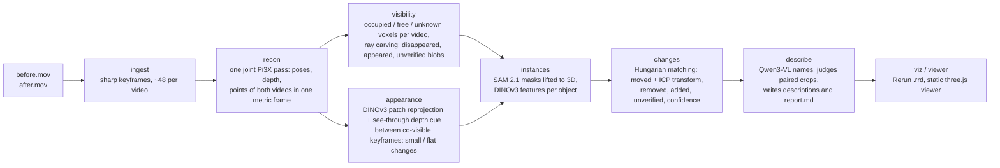

# RoomDiff — what changed in the room?

RoomDiff compares two phone videos of the same room, recorded at different times and
from different viewpoints, and reports which objects were **added**, **removed** or
**moved**, with their 3D location, a semantic label and a short description. Both
videos are reconstructed into one shared 3D frame; every reported change is backed by
explicit geometric, appearance and visual-language evidence, and changes in space the
other video never observed are reported as **unverified** instead of being guessed.
See [docs/PLAN.md](docs/PLAN.md) for the design.


*The web viewer on SceneDiff pair living_room_1: both point clouds in one frame, a box per change (red removed, green added, blue moved with an arrow from the old place, yellow unverified) and the change list with its evidence and crops. Live: <https://jjq7.github.io/RoomDiff/viewer/?scene=scenes/scenediff_living_room_1>.*


## How it works



Geometry proposes, appearance fills in what geometry cannot see, the vision-language
model judges and names. A change is only `removed` or `added` if the other video looked
at that place and saw it empty; space the other video never observed is `unverified`.

## Install

Tested on Ubuntu 24.04 under WSL2 with Python 3.12 and an RTX 5090 (the pipeline needs a
CUDA GPU with about 22 GiB free: Qwen3-VL-8B alone takes 16.7 GiB, the Pi3X pass on 96
keyframes 12.4 GiB; the two never run at the same time). Exact package pins are in
`requirements.lock.txt`.

```bash
git clone https://github.com/JJQ7/RoomDiff.git && cd RoomDiff
python3.12 -m venv .venv && source .venv/bin/activate
# torch for your CUDA; the RTX 5090 (sm_120) needs the cu128 wheels
pip install torch==2.10.0 torchvision==0.25.0 --index-url https://download.pytorch.org/whl/cu128
pip install -e .                                   # roomdiff + dependencies (pyproject.toml)
# Pi3X reconstruction model code (not on PyPI); --no-deps keeps our numpy 2.x
git clone https://github.com/yyfz/Pi3.git third_party/Pi3
pip install --no-deps -e third_party/Pi3
```

Model weights are read from the Hugging Face cache; download them once (about 25 GB).
DINOv3 is gated: accept its terms on the model page and `hf auth login` first.

```bash
hf download yyfz233/Pi3X model.safetensors          # reconstruction (5.4 GB)
hf download facebook/sam2.1-hiera-large             # instance masks (1.7 GB)
hf download facebook/dinov3-vitl16-pretrain-lvd1689m   # appearance features (1.2 GB, gated)
hf download Qwen/Qwen3-VL-8B-Instruct               # semantics (17 GB)
```

Notes: video decoding uses PyAV's bundled FFmpeg, so no system `ffmpeg` is needed. Open3D
needs `libusb-1.0.so.0` (`sudo apt install libusb-1.0-0`; without root, `apt-get download
libusb-1.0-0`, extract the `.so` and put it in `.venv/lib/`). The SceneDiff benchmark
(`roomdiff eval`) additionally needs the dataset under `data/scenediff/scenediff_benchmark/`
and the official evaluator: `git clone https://github.com/yuqunw/scene_diff.git third_party/scene_diff`.

## Run

```bash
# full pipeline (about 2 minutes on an RTX 5090): ingest -> recon -> visibility ->
# appearance -> instances -> changes -> describe -> viz -> viewer
roomdiff run --before before.mov --after after.mov --out outputs/scene1
# any value in configs/default.yaml can be overridden (or use --config scene.yaml)
roomdiff run ... --set ingest.num_keyframes=32 --set ingest.max_side=768
# single stages on an existing output folder (each stage caches its result), e.g.
roomdiff describe --out outputs/scene1
roomdiff viewer --out outputs/scene1
```

`roomdiff` is the console script of the package (`python -m roomdiff.cli` is the same).
An optional last stage, `roomdiff recheck` (`--set recheck.enabled=true`), asks SAM 3 for
each change's label on the object and at its place in the other video and records the
answer as extra evidence; it is off by default because it did not improve the benchmark
(see the design note).
The results of a run are `outputs/scene1/report.md` (every change with its evidence and
crops, a summary and the rejected candidates), `changes.json` (the machine-readable list,
see `docs/interfaces.md`), `scene.rrd` (open with `rerun scene.rrd`) and `viewer/`.

- **Semantics and report** (`describe`): Qwen3-VL-8B (local, bf16, about 16.6 GiB VRAM,
  30-60 s per scene) names every change from its crops, judges it on paired before/after
  crops (wall, floor, mirror-reflection and shadow regions are moved to a `rejected` list
  with the reason), merges changes that were split across two candidates (a removed and an
  added part of the same object become one `moved` change), and writes one-sentence
  descriptions, a summary, `<out>/report.md` and the VLM log `<out>/semantics/log.jsonl`.
  Settings: `configs/default.yaml: semantics`.

- **Diagnostics**: `python scripts/plot_align.py outputs/scene1` renders top-down and side views of the before/after clouds (`<out>/recon/<run>_{top,side}.png`) to check the alignment by eye.

## Example outputs

Three pairs of the SceneDiff benchmark, run end to end with the default settings
(`examples/<scene>/report.md`, `changes.json` and the crops; the point clouds are in the
live viewer linked below). Each crop shows the object's mask outline in the keyframe that
sees it best; "place" crops show the same spot in the other video.

| scene | result | ground truth |
|---|---|---|
| [office_1](examples/scenediff_office_1/report.md) | 1 chair removed, 1 chair moved 0.6 m and turned 54 deg | exactly that |
| [bedroom_1](examples/scenediff_bedroom_1/report.md) | jacket removed, bedding moved (deformed), tissue box moved (labelled "cardboard box"); bedside table unverified | pyjamas also moved (missed: judged "same") |
| [living_room_1](examples/scenediff_living_room_1/report.md) | bag and wallet removed, hairbrush added, ladder shelf and one curtain moved, second curtain removed | second curtain was moved, not removed |

| [office_1](examples/scenediff_office_1/report.md) | [bedroom_1](examples/scenediff_bedroom_1/report.md) | [living_room_1](examples/scenediff_living_room_1/report.md) |
|---|---|---|
| [](examples/scenediff_office_1/report.md) | [](examples/scenediff_bedroom_1/report.md) | [](examples/scenediff_living_room_1/report.md) |

*After clouds with the reported changes (`scripts/render_scene.py`): red / green / blue boxes = removed / added / moved (dashed = the old place), grey dashed = unverified. Below, the living room before and after:*


| office_1: moved chair, before / after | living_room_1: removed wallet, before / after |
|---|---|
|   |   |

From the office report, the moved chair's entry reads: *"The office chair (grey fabric
seat, black mesh back; about 0.5 x 0.5 x 0.4 m) was shifted 0.6 m within the near part of
the room ... and rotated about 54 degrees; the later video shows its old spot empty from 7
viewpoints and the earlier video shows the new spot empty from 32 viewpoints."* An evidence
line follows (free-space views, appearance similarity, displacement, mask score and the
VLM's reason), then the four crops.

## Held-out scenes: our own recordings

Three pairs recorded on 13 October 2026 with an iPhone 13 Pro (plain camera app, 31-43 s
each, walking around a low table), four states in a row: each pair compares consecutive
states, and the changes were staged and written down before any run
(`examples/tabletop_*/gt.yaml`). The pipeline ran once per pair with the default settings;
nothing was tuned on these videos. One detail was fixed after the first run: the third
video was recorded landscape and the others portrait, which ingest handled by turning that
recording a quarter turn; Pi3X then reconstructed the turned video with a slight offset and
the whole table top came out as "added", so ingest now centre-crops both videos of a mixed
pair to squares instead, and the two affected pairs were re-run once (see the design note).
LiDAR scans of every state (3D Scanner App) were used only afterwards, to check the scale.

| pair | staged changes | reported (`examples/<pair>/report.md`) | score (`gt_score.md`) |
|---|---|---|---|
| [tabletop_1](examples/tabletop_1/report.md) | biscuit box added, tea canister removed, white box moved | white box moved 0.44 m and turned 54 deg, tea canister removed; a bin in the background "moved" 0.10 m; the biscuit box was found but rejected by the VLM judge | 2 / 3 found, 1 false positive |
| [tabletop_2](examples/tabletop_2/report.md) | tea canister added, scissors removed, bucket moved to the other end of the table | tea canister added, scissors removed, bucket added at its new place (its old place was not flagged) | 2 / 3 found, 1 half, 0 false positives |
| [tabletop_3](examples/tabletop_3/report.md) | detergent bottle moved; tea canister and stool put on the floor under the table edge, where the second video barely sees them (an occlusion test) | detergent bottle moved 0.30 m and turned 24 deg; tea canister reported removed (its old place was seen empty, its new place never observed; named "canned food"); stool not detected; suitcase and cookie box unverified | 1 / 3 found, 1 half, 0 false positives |

| [tabletop_1](examples/tabletop_1/report.md) | [tabletop_2](examples/tabletop_2/report.md) | [tabletop_3](examples/tabletop_3/report.md) |
|---|---|---|
| [](examples/tabletop_1/report.md) | [](examples/tabletop_2/report.md) | [](examples/tabletop_3/report.md) |

Live viewer: [tabletop_1](https://jjq7.github.io/RoomDiff/viewer/?scene=scenes/tabletop_1),
[tabletop_2](https://jjq7.github.io/RoomDiff/viewer/?scene=scenes/tabletop_2),
[tabletop_3](https://jjq7.github.io/RoomDiff/viewer/?scene=scenes/tabletop_3).

What the scans added (`examples/<pair>/lidar_check.md`): our clouds fit the LiDAR meshes
with a median residual of 1.7-2.9 cm, but at a scale of 0.55-0.57 for all six recordings
(the two scans of a pair agree within 0.7-3.6 %): on these close-range, top-down videos
Pi3X's metric scale is 1.8x too large, so the distances above are the reported ones times
that scale (`scripts/score_gt.py --scale`), and the reports keep saying "approx. metres".
The misses are instructive too: the biscuit box was detected by the appearance channel
with confidence 0.90 and then rejected because Qwen3-VL claimed the box was in both crops
(`examples/tabletop_1/crops/7_*.jpg` show it is not); the bucket's and the tea canister's
new places got a change of one type only, because the old place was seen empty but the
new place was not (bucket) or never observed (canister); and the stool under the table
was never segmented. A suitcase that was not part of the staging and stands at a different
place in the second video came back as unverified, correctly: the first video never looked
at that spot.

## Web viewer

A static three.js viewer (source in `viewer/`, no build step; three.js is loaded from
unpkg, so it needs an internet connection) shows the before/after clouds with the change
boxes, a per-change list with evidence and crops, before/after/both and tint toggles.

```bash
# writes outputs/scene1/viewer/: before.ply, after.ply (<= 400k points each), changes.json,
# crops/, scene.json and a copy of the viewer app
python -m roomdiff.cli viewer --out outputs/scene1 [--target-points 400000]
# browsers block data loading from file:// pages, so serve the folder:
cd outputs/scene1/viewer && python -m http.server 8000   # open http://localhost:8000/
```

Keys: N / P next / previous change, R reset view. `changes.json` is taken from
`<out>/changes.json`, or generated from `<out>/visibility/candidates.json` (geometry-only
regions) when the change stage has not run yet.

Figures for a report: `python scripts/shoot_viewer.py outputs/scene1 --out docs/img/viewer/scene1 --gif both`
screenshots the viewer headlessly (Playwright with Chromium: the overview, one close-up
per change, an orbit GIF and a before/after GIF), and `python scripts/render_scene.py
outputs/scene1 --out docs/img/scene1 --gif` renders the same overview without a browser.

GitHub Pages layout (several scenes, one copy of the app):

```
docs/viewer/index.html, app.js, style.css       # copied from viewer/
docs/viewer/scenes/<name>/                      # contents of outputs/<name>/viewer/
```

Live examples: <https://jjq7.github.io/RoomDiff/viewer/?scene=scenes/scenediff_living_room_1>
(a SceneDiff benchmark pair) and `scenes/tabletop_1`, `tabletop_2`, `tabletop_3` (our own
recordings). Without `?scene=` the viewer loads `./scene.json` from its own folder. `*.ply` is gitignored except under `docs/viewer/scenes/` and `examples/`.

## Capture-day tools

CPU-only helpers for your own recordings; the `gt.yaml` schema and the matching rules are in
`docs/capture_protocol.md` (template: `docs/gt_template.yaml`).
* `python scripts/check_video.py before.mov after.mov [--json out.json]`: one PASS / WARN / FAIL
  line per check (duration, orientation, codec / HDR, sharpness, usable keyframes, fast pans),
  exit 1 on a hard failure; run it before leaving the room. One portrait and one landscape
  video only warns: ingest centre-crops both to squares.
* `python scripts/score_gt.py outputs/<scene> data/scenes/<scene>/gt.yaml [--json] [--scale S]`:
  matches `changes.json` to the ground truth (each object may list `aliases`): found / type
  correct / missed, displacement and rotation errors, false positives, objects deliberately
  seen in one video only.
* `python scripts/lidar_check.py outputs/<scene> --before lidar/before.obj --after lidar/after.obj [--json]`:
  fits a gravity-aligned Sim(3) between the reconstruction and iPhone LiDAR scans (3D Scanner
  App export, PLY point cloud or OBJ mesh; a scan of part of the room is fine): metric scale,
  yaw, residuals, before / after consistency, and the reported distances and sizes converted
  to metres.

## Benchmark (SceneDiff validation subset)

`roomdiff eval` runs the pipeline on pairs of the public
[SceneDiff](https://github.com/scenediff/scene_diff) benchmark and scores them with the
official evaluator (`third_party/scene_diff`). 20 pairs of the `val` / `varied` split,
fixed keyframes every 1 s, RTX 5090:

| | per-view AP | per-scene AP | AP (typed) | global IoU | objects TP / FP / FN |
|---|---|---|---|---|---|
| geometry channel only (commit `ce23def`) | 0.151 | 0.083 | 0.078 | 0.187 | 7 / 42 / 68 |
| + appearance channel (commit `c660672`) | **0.395** | 0.352 | 0.238 | 0.331 | 30 / 53 / 45 |
| same, keyframes every 0.5 s (commit `ad1b585`) | 0.394 | **0.383** | **0.256** | **0.351** | 32 / 61 / 43 |
| SceneDiff paper (full val set, for reference) | 0.496 | 0.463 | 0.255 | – | – |

The paper numbers are on the whole validation set, ours on a 20-pair subset, so they are
indicative only. Median run time per pair: 70 s at 1 s keyframes, 85 s at 0.5 s (RTX
5090). The remaining gap is recall on small objects in recordings with few co-visible
keyframes and the precision of the VLM judge; see `docs/design_note.md`.

```bash
python -m roomdiff.cli eval --split val --set varied --limit 20 --out-root outputs/scenediff_eval \
    -o ingest.mode=fixed -o ingest.fixed_interval_s=0.5     # -o overrides config values here
```

## Development

```bash
.venv/bin/python -m pytest tests -q                 # CPU only, synthetic scenes, no weights
~/.local/bin/uvx --offline ruff check roomdiff tests scripts   # or: uvx ruff check ...
```

The ruff rule selection is pinned in `pyproject.toml` (`[tool.ruff.lint]`: E, F, W, B, I,
UP, C4, SIM, PIE, PERF, PLE, PLW, FURB, RUF, BLE, TRY004; line length 100), so the result
does not depend on the default rule set of the installed ruff version.
