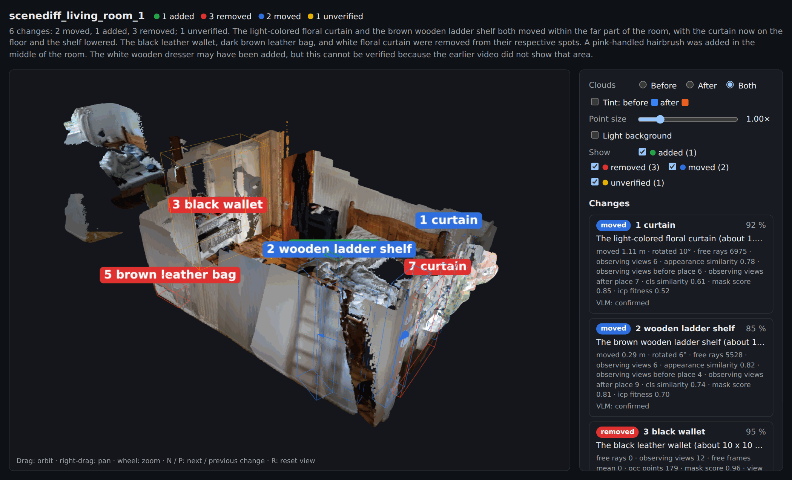
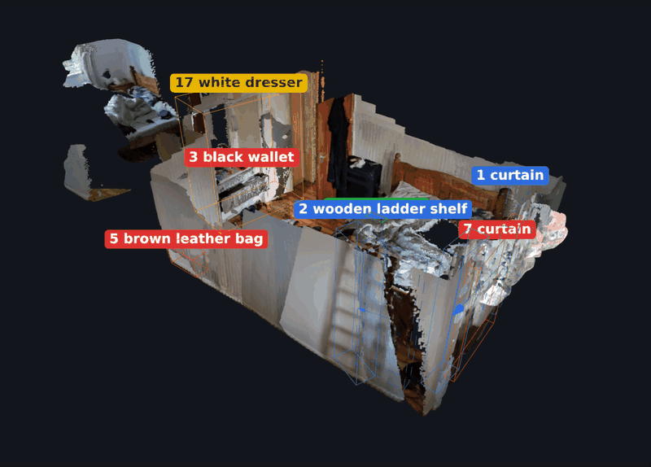
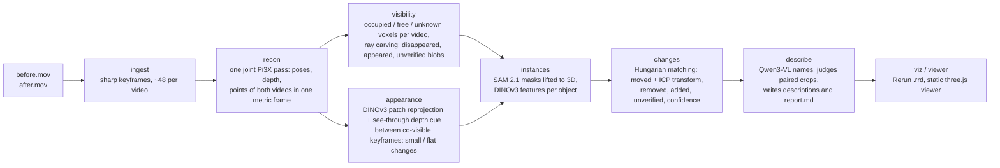
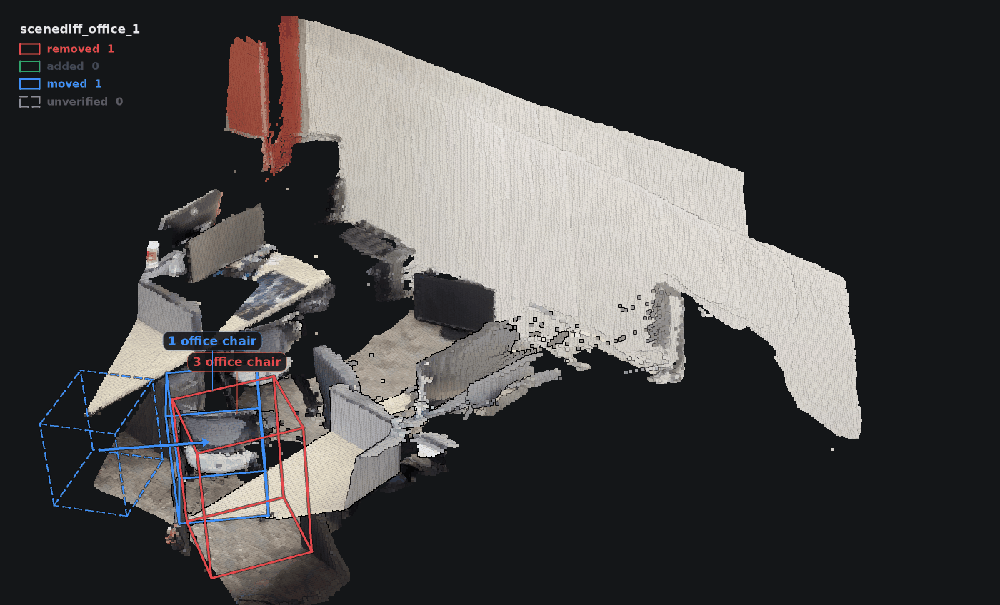
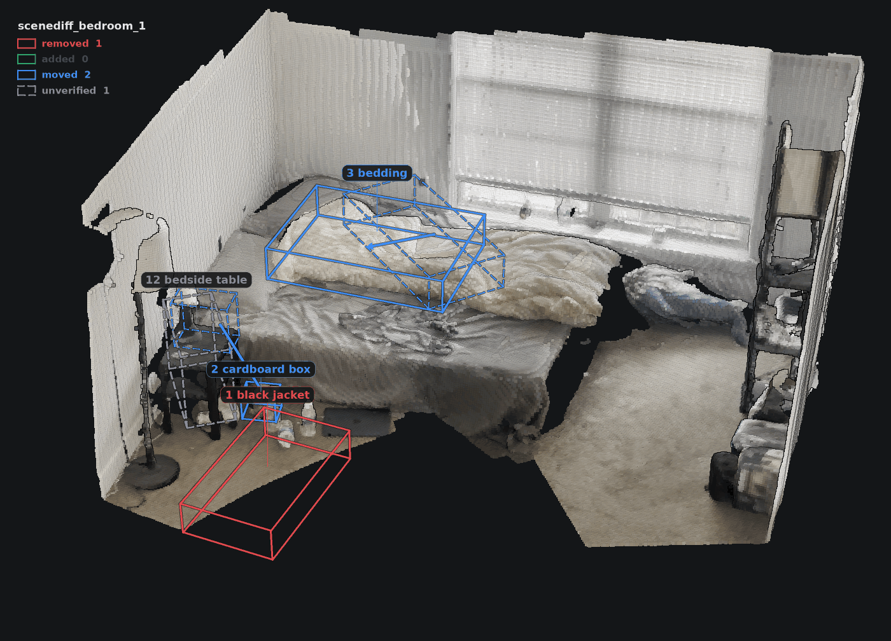
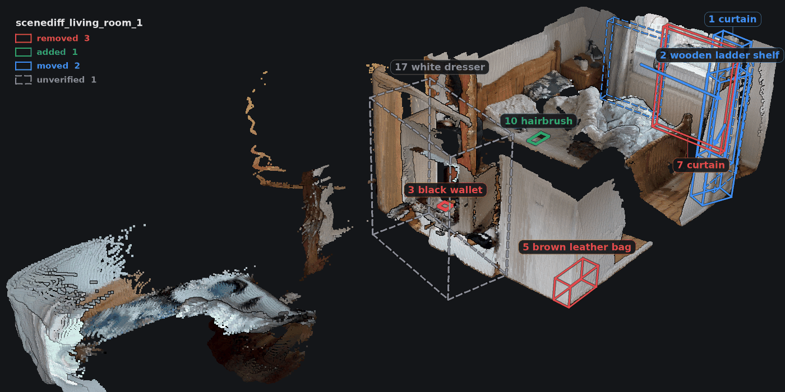
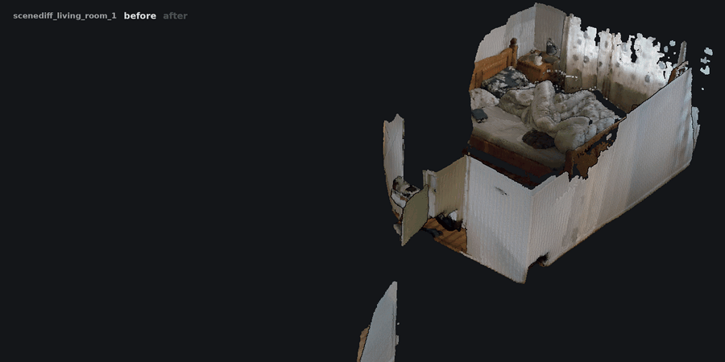
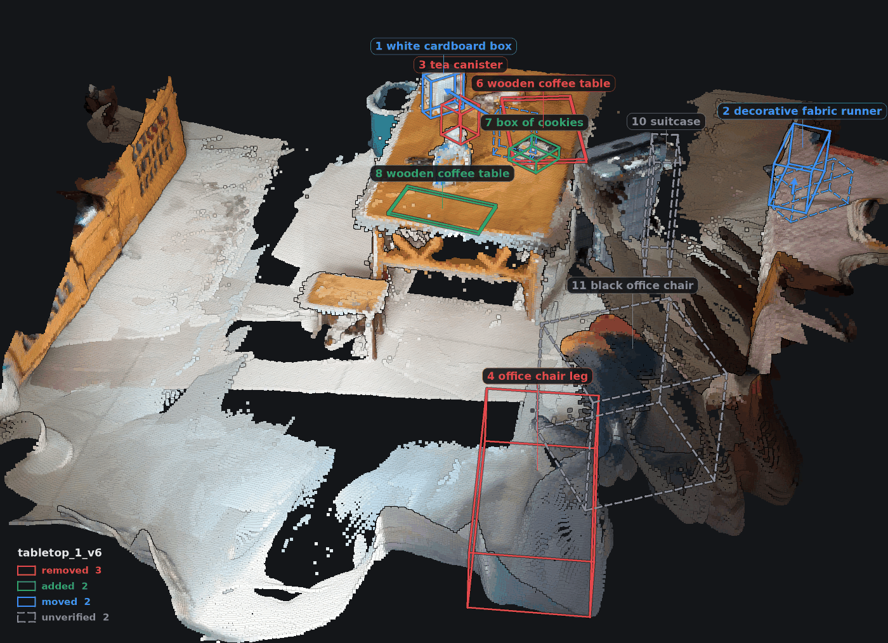
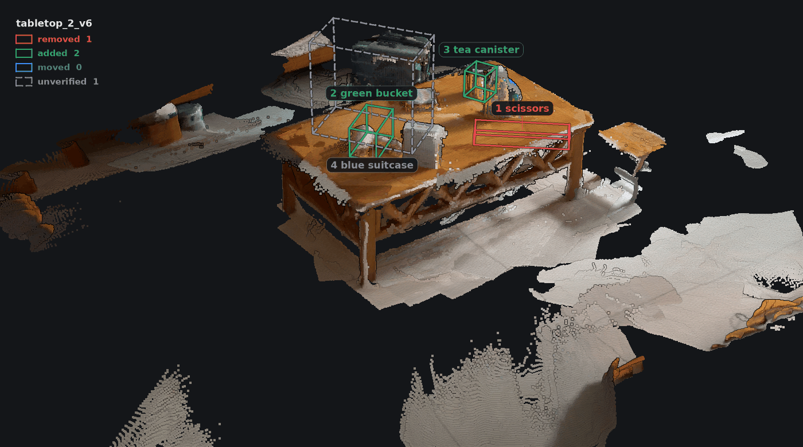
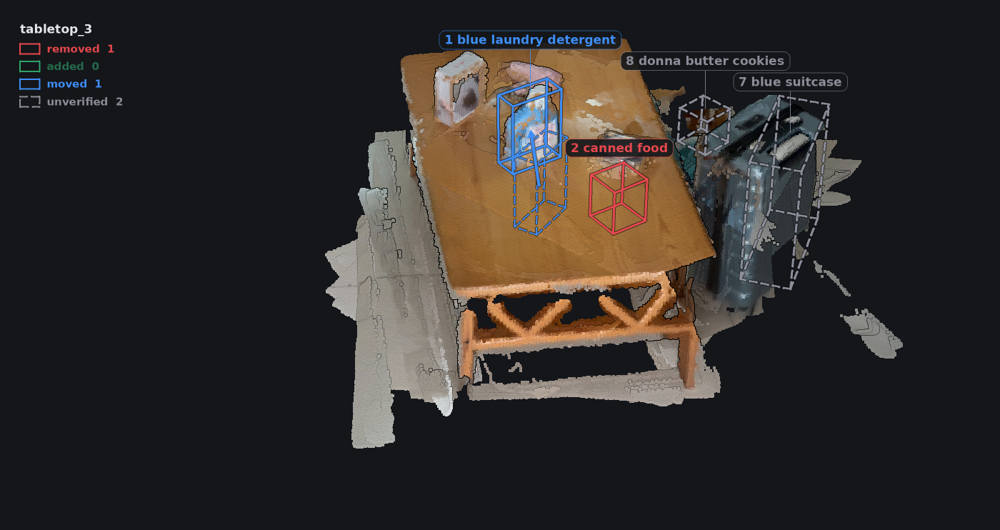

# RoomDiff — what changed in the room?

RoomDiff compares two phone videos of the same room, recorded at different times and
from different viewpoints, and reports which objects were **added**, **removed** or
**moved**, with their 3D location, a semantic label and a short description. Both
videos are reconstructed into one shared 3D frame; every reported change is backed by
explicit geometric, appearance and visual-language evidence, and changes in space the
other video never observed are reported as **unverified** instead of being guessed.
The choices behind it, what was tried and what is known not to work are in
[docs/design_note.md](docs/design_note.md); [docs/PLAN.md](docs/PLAN.md) is the day-1 plan,
kept for the record; a map of the documentation is at the end of this README.

*By Jingqi Jiang (Imperial College London), October 2026: a five-day take-home challenge,
"What changed in the room?".*



*The web viewer on SceneDiff pair living_room_1: both point clouds in one frame, a box per change (red removed, green added, blue moved with an arrow from the old place, yellow unverified) and the change list with its evidence and crops. Live: <https://jjq7.github.io/RoomDiff/viewer/?scene=scenes/scenediff_living_room_1>.*



## Results at a glance

Scored with the official evaluator of the public [SceneDiff](https://github.com/yuqunw/scene_diff)
benchmark (default settings; the 20-pair row is the final code, the 105-pair rows were run
on 15 October, before the floor cut of the next day, which changed the 20-pair numbers by one
object; the full table and what each row changed are in the
[benchmark section](#benchmark-scenediff-validation-subset)):

| | per-view AP | per-scene AP | typed AP |
|---|---|---|---|
| SceneDiff `val` / `varied`, the 20 pairs reported during development | 0.474 | 0.444 | 0.325 |
| SceneDiff whole `val` set, 105 pairs | 0.385 | 0.351 | 0.242 |
| its `varied` half, 50 pairs | 0.552 | 0.517 | 0.416 |
| its `kitchen` half, 55 pairs (short sweeps, little overlap between the videos) | 0.187 | 0.183 | 0.076 |
| SceneDiff paper, whole `val` set, for reference | 0.496 | 0.463 | 0.255 |

On [our own three tabletop pairs](#held-out-scenes-our-own-recordings) (held out, each run once
with frozen settings) 5 of the 9 staged changes came back with the right type and object, 2 more
as one half, with 1 false positive. A pair takes about 2 minutes on an RTX 5090; everything runs
locally, no API keys.

## How it works



Geometry proposes, appearance fills in what geometry cannot see, the vision-language
model judges and names. What a `removed` or `added` change rests on depends on the channel:

- geometry: the other video's camera rays carved that space empty (free in at least 2 of
  its keyframes, more than 4 cm from its surfaces); occupied space the other video never
  observed is `unverified` instead, without the voxels within 6 cm of the floor plane (a
  patch of floor that one video filmed is not an object);
- appearance (small or flat objects the voxels miss, e.g. a wallet on a table): no
  free-space test; keyframes of the other video look at the same place (depth-consistent
  reprojection) and see different DINOv3 features there, sometimes also a depth cue (they
  see through the place to a surface behind it).

Every candidate of both channels then goes to the VLM judge, which sees the object and,
where there is one, the other video's view of the place; an appearance change is asked
what changed at that place, and "same" rejects it.

The recon stage checks that the two reconstructions line up on the points both videos
see (verdict OK / FAIR / WEAK in the report, with the share of those points within 3 cm);
a WEAK verdict can turn every removed / added candidate of the geometry channel into
`unverified` (`visibility.weak_alignment_demotes`), but that is off by default: on the one
WEAK pair of each benchmark subset it removed the false changes and the correct ones with
them (design note, section 2).

## Install

Tested on Ubuntu 24.04 under WSL2 with Python 3.12 and an RTX 5090 (the pipeline needs a
CUDA GPU with about 22 GiB free: Qwen3-VL-8B alone takes 16.7 GiB, the Pi3X pass on 96
keyframes 12.4 GiB; the two never run at the same time). Exact package pins are in
`requirements.lock.txt`.

```bash
git clone https://github.com/JJQ7/RoomDiff.git && cd RoomDiff
python3.12 -m venv .venv && source .venv/bin/activate
# torch for your CUDA; the RTX 5090 (sm_120) needs the cu128 wheels
pip install torch==2.10.0 torchvision==0.25.0 --index-url https://download.pytorch.org/whl/cu128
pip install -e .                                   # roomdiff + dependencies (pyproject.toml)
# Pi3X reconstruction model code (not on PyPI) at the tested commit; --no-deps keeps numpy 2.x
git clone https://github.com/yyfz/Pi3.git third_party/Pi3 && git -C third_party/Pi3 checkout 9fa3ddb
pip install --no-deps -e third_party/Pi3
```

Model weights are read from the Hugging Face cache; download them once (about 25 GB).
DINOv3 is gated: accept its terms on the model page and `hf auth login` first.

```bash
hf download yyfz233/Pi3X model.safetensors            # reconstruction (5.4 GB), rev bb1deea4d7
hf download facebook/sam2.1-hiera-large               # instance masks (1.7 GB), rev 665f8e2ad6
hf download facebook/dinov3-vitl16-pretrain-lvd1689m  # appearance (1.2 GB, gated), rev ea8dc2863c
hf download Qwen/Qwen3-VL-8B-Instruct                 # semantics (17 GB), rev 0c351dd01e
```

The comments give the revision of each model used for the results in this README (each
repository's `main` on 12 October 2026, as listed in `docs/env_report.md`). The code
loads `main` from this cache, and `ls ~/.cache/huggingface/hub/models--yyfz233--Pi3X/snapshots/`
(likewise for the others) shows the revision you got. (`hf download --revision <hash>`
fetches exactly these files but does not record them as `main`, which is what the code asks
the cache for.)

Notes: video decoding uses PyAV's bundled FFmpeg, so no system `ffmpeg` is needed. Open3D
needs `libusb-1.0.so.0` (`sudo apt install libusb-1.0-0`; without root, `apt-get download
libusb-1.0-0`, extract the `.so` and put it in `.venv/lib/`). The SceneDiff benchmark
(`roomdiff eval`) additionally needs the dataset under `data/scenediff/scenediff_benchmark/`
and the official evaluator; the optional SAM 3 re-check (`roomdiff recheck`) needs SAM 3,
whose package pins numpy < 2 (hence `--no-deps` and two of its dependencies by hand). Both
at the tested commits:

```bash
git clone https://github.com/yuqunw/scene_diff.git third_party/scene_diff && git -C third_party/scene_diff checkout 62dcbd2
git clone https://github.com/facebookresearch/sam3.git third_party/sam3 && git -C third_party/sam3 checkout 0570b3a
pip install --no-deps -e third_party/sam3 && pip install ftfy==6.1.1 iopath==0.1.10
hf download facebook/sam3 sam3.pt                     # SAM 3 checkpoint (3.5 GB, gated), rev 3c879f3982
```

### Licences

| component | licence | source |
|---|---|---|
| RoomDiff (this repository: code, docs, viewer) | MIT | [`LICENSE`](LICENSE); the models it runs keep their own licences below, so a run of the full pipeline is non-commercial because of the Pi3X weights |
| Pi3 code (`third_party/Pi3`) | BSD 3-Clause | `third_party/Pi3/LICENSE` |
| Pi3X weights (`yyfz233/Pi3X`) | CC BY-NC 4.0: non-commercial use only | `third_party/Pi3/README.md` ("License"); [model card](https://huggingface.co/yyfz233/Pi3X) |
| SAM 2.1 (`facebook/sam2.1-hiera-large`) | Apache-2.0 | [model card](https://huggingface.co/facebook/sam2.1-hiera-large) |
| DINOv3 (`facebook/dinov3-vitl16-pretrain-lvd1689m`) | DINOv3 License (Meta; gated) | `LICENSE.md` in the [model repository](https://huggingface.co/facebook/dinov3-vitl16-pretrain-lvd1689m) |
| Qwen3-VL-8B-Instruct (`Qwen/Qwen3-VL-8B-Instruct`) | Apache-2.0 | [model card](https://huggingface.co/Qwen/Qwen3-VL-8B-Instruct) |
| SceneDiff evaluator (`third_party/scene_diff`) | MIT | `third_party/scene_diff/LICENSE` |
| SAM 3 code and weights (optional: `third_party/sam3`, `facebook/sam3`) | SAM License (Meta; weights gated) | `third_party/sam3/LICENSE`, same text in the [model repository](https://huggingface.co/facebook/sam3) |
| three.js r160 (vendored in `viewer/vendor/three/`) | MIT | `viewer/vendor/three/LICENSE` |

## Run

```bash
# full pipeline (about 2 minutes on an RTX 5090): ingest -> recon -> visibility ->
# appearance -> instances -> changes -> describe -> viz -> viewer
roomdiff run --before before.mov --after after.mov --out outputs/scene1
# any value in configs/default.yaml can be overridden (or use --config scene.yaml)
roomdiff run ... --set ingest.num_keyframes=32 --set ingest.max_side=768
# single stages on an existing output folder (each stage caches its result), e.g.
roomdiff describe --out outputs/scene1
roomdiff viewer --out outputs/scene1
```

`roomdiff` is the console script of the package (`python -m roomdiff.cli` is the same).
An optional last stage, `roomdiff recheck` (`--set recheck.enabled=true`), asks SAM 3 for
each change's label on the object and at its place in the other video and records the
answer as extra evidence; it is off by default because it did not improve the benchmark
(see the design note).
The results of a run are `outputs/scene1/report.md` (every change with its evidence and
crops, a summary and the rejected candidates), `changes.json` (the machine-readable list,
see `docs/interfaces.md`), `scene.rrd` (open with `rerun scene.rrd`) and `viewer/`.

- **Semantics and report** (`describe`): Qwen3-VL-8B (local, bf16, about 16.6 GiB VRAM,
  30-60 s per scene) names every change from its crops, judges it on paired before/after
  crops (wall, floor, mirror-reflection and shadow regions are moved to a `rejected` list
  with the reason), merges changes that were split across two candidates (a removed and an
  added part of the same object become one `moved` change), and writes one-sentence
  descriptions, a summary, `<out>/report.md` and the VLM log `<out>/semantics/log.jsonl`.
  Settings: `configs/default.yaml: semantics`.

- **Diagnostics**: `python scripts/plot_align.py outputs/scene1` renders top-down and side views of the before/after clouds (`<out>/recon/<run>_{top,side}.png`) to check the alignment by eye.

## Example outputs

Three pairs of the SceneDiff benchmark, run end to end with the default settings of
commit `ad1b585` (`examples/<scene>/report.md`, `changes.json` and the crops; the point
clouds are in the live viewer linked below). The final judge prompt (`describe_first`,
benchmark section) leaves office_1 identical, adds one "removed grey blanket" to bedroom_1
and renames the living room's second curtain to "dark blanket". Each crop shows the object's mask outline in the keyframe that
sees it best; "place" crops show the same spot in the other video.

| scene | result | ground truth |
|---|---|---|
| [office_1](examples/scenediff_office_1/report.md) | 1 chair removed, 1 chair moved 0.6 m and turned 54 deg | exactly that |
| [bedroom_1](examples/scenediff_bedroom_1/report.md) | jacket removed, bedding moved (deformed), tissue box moved (labelled "cardboard box"); bedside table unverified | pyjamas also moved (missed: judged "same") |
| [living_room_1](examples/scenediff_living_room_1/report.md) | bag and wallet removed, hairbrush added, ladder shelf and one curtain moved, second curtain removed | second curtain was moved, not removed |

| [office_1](examples/scenediff_office_1/report.md) | [bedroom_1](examples/scenediff_bedroom_1/report.md) | [living_room_1](examples/scenediff_living_room_1/report.md) |
|---|---|---|
| [](examples/scenediff_office_1/report.md) | [](examples/scenediff_bedroom_1/report.md) | [](examples/scenediff_living_room_1/report.md) |

Live viewer: [office_1](https://jjq7.github.io/RoomDiff/viewer/?scene=scenes/scenediff_office_1),
[bedroom_1](https://jjq7.github.io/RoomDiff/viewer/?scene=scenes/scenediff_bedroom_1),
[living_room_1](https://jjq7.github.io/RoomDiff/viewer/?scene=scenes/scenediff_living_room_1).

*After clouds with the reported changes (`scripts/render_scene.py`): red / green / blue boxes = removed / added / moved (dashed = the old place), grey dashed = unverified. Below, the living room before and after:*



| office_1: moved chair, before / after | living_room_1: removed wallet, before / after |
|---|---|
|   |   |

From the office report, the moved chair's entry reads: *"The office chair (grey fabric
seat, black mesh back; about 0.5 x 0.5 x 0.4 m) was shifted 0.6 m within the near part of
the room ... and rotated about 54 degrees; the later video shows its old spot empty from 7
viewpoints and the earlier video shows the new spot empty from 32 viewpoints."* An evidence
line follows (free-space views, appearance similarity, displacement, mask score and the
VLM's reason), then the four crops.

## Held-out scenes: our own recordings

Three pairs recorded on 13 October 2026 with an iPhone 13 Pro (plain camera app, 31-43 s
each, walking around a low table), four states in a row: each pair compares consecutive
states, and the changes were staged and written down before any run
(`examples/tabletop_*/gt.yaml`). The pipeline ran once per pair with the default settings;
nothing was tuned on these videos. One detail was fixed after the first run: the third
video was recorded landscape and the others portrait, which ingest handled by turning that
recording a quarter turn; Pi3X then reconstructed the turned video with a slight offset and
the whole table top came out as "added", so ingest now centre-crops both videos of a mixed
pair to squares instead, and the two affected pairs were re-run once (see the design note).
LiDAR scans of every state (3D Scanner App) were used only afterwards, to check the scale.

| pair | staged changes | reported (`examples/<pair>/report.md`) | score (`gt_score.md`) |
|---|---|---|---|
| [tabletop_1](examples/tabletop_1/report.md) | biscuit box added, tea canister removed, white box moved | white box moved 0.44 m and turned 54 deg, tea canister removed; a bin in the background "moved" 0.10 m; the biscuit box was found but rejected by the VLM judge | 2 / 3 found, 1 false positive |
| [tabletop_2](examples/tabletop_2/report.md) | tea canister added, scissors removed, bucket moved to the other end of the table | tea canister added, scissors removed, bucket added at its new place (its old place was not flagged) | 2 / 3 found, 1 half, 0 false positives |
| [tabletop_3](examples/tabletop_3/report.md) | detergent bottle moved; tea canister and stool put on the floor under the table edge, where the second video barely sees them (an occlusion test) | detergent bottle moved 0.30 m and turned 24 deg; tea canister reported removed (its old place was seen empty, its new place never observed; named "canned food"); stool not detected; suitcase and cookie box unverified | 1 / 3 found, 1 half, 0 false positives |

| [tabletop_1](examples/tabletop_1/report.md) | [tabletop_2](examples/tabletop_2/report.md) | [tabletop_3](examples/tabletop_3/report.md) |
|---|---|---|
| [](examples/tabletop_1/report.md) | [](examples/tabletop_2/report.md) | [](examples/tabletop_3/report.md) |

*After clouds of the re-run with the final code (16 October, see "Floor is not an object"
below), the run the live viewer shows; the table above and `examples/tabletop_*` describe
the first, frozen run.*

Live viewer: [tabletop_1](https://jjq7.github.io/RoomDiff/viewer/?scene=scenes/tabletop_1),
[tabletop_2](https://jjq7.github.io/RoomDiff/viewer/?scene=scenes/tabletop_2),
[tabletop_3](https://jjq7.github.io/RoomDiff/viewer/?scene=scenes/tabletop_3).

Inputs to run them yourself are in the [`data-v1` release](https://github.com/JJQ7/RoomDiff/releases/tag/data-v1):
[tabletop_1.zip](https://github.com/JJQ7/RoomDiff/releases/download/data-v1/tabletop_1.zip),
[tabletop_2.zip](https://github.com/JJQ7/RoomDiff/releases/download/data-v1/tabletop_2.zip),
[tabletop_3.zip](https://github.com/JJQ7/RoomDiff/releases/download/data-v1/tabletop_3.zip)
(37-39 MB each: both videos re-encoded to H.264 at about 3.7 Mbps, the two LiDAR meshes and
`gt.yaml`), or `tabletop_<k>_original.zip` (142-154 MB, the untouched iPhone `.mov` files
the results above come from; the re-encoded copies pick slightly different keyframes and
gave the same found changes with 2 / 0 / 1 false positives instead of 1 / 0 / 0).

```bash
unzip tabletop_1.zip -d data/scenes/
python -m roomdiff.cli run --before data/scenes/tabletop_1/before.mp4 --after data/scenes/tabletop_1/after.mp4 --out outputs/tabletop_1
python scripts/score_gt.py outputs/tabletop_1 data/scenes/tabletop_1/gt.yaml
python scripts/lidar_check.py outputs/tabletop_1 --before data/scenes/tabletop_1/lidar/before.obj --after data/scenes/tabletop_1/lidar/after.obj
```

What the scans added (`examples/<pair>/lidar_check.md`): our clouds fit the LiDAR meshes
with a median residual of 1.7-2.9 cm, but at a scale of 0.55-0.57 for all six recordings
(the two scans of a pair agree within 0.7-3.6 %): on these close-range, top-down videos
Pi3X's metric scale is 1.8x too large, so the distances above are the reported ones times
that scale (`scripts/score_gt.py --scale`), and the reports keep saying "approx. metres".
The misses are instructive too: the biscuit box was detected by the appearance channel
with confidence 0.90 and then rejected because Qwen3-VL claimed the box was in both crops
(`examples/tabletop_1/crops/7_*.jpg` show it is not); the bucket's and the tea canister's
new places got a change of one type only, because the old place was seen empty but the
new place was not (bucket) or never observed (canister); and the stool under the table
was never segmented. A suitcase that was not part of the staging and stands at a different
place in the second video came back as unverified, correctly: the first video never looked
at that spot.

These are the results of the first run, with the judge prompts of commit `ad1b585`;
`examples/tabletop_*` hold that run. The final judge prompt (`semantics.describe_first`,
adopted afterwards for its benchmark gain, see below) was then tried on the same
reconstructions by re-running the describe stage only: it finds the biscuit box too
(tabletop_1 becomes 3 / 3) but also accepts four table and chair regions seen from
different viewpoints as changes (tabletop_1 + 3 false positives, tabletop_3 + 1,
tabletop_2 unchanged). On close-range, top-down video it trades precision for recall.
Run once more with the final code of 14 October (the `8c8263b` row of the benchmark
table): tabletop_1 finds all three changes (biscuit box added, tea canister removed, white
box moved 0.44 m and turned 54 deg after the LiDAR scale) with four false positives (the
background bin again, now named a fabric runner, plus a chair leg and a coffee table seen
from new viewpoints as removed and added); tabletop_2 is unchanged (tea canister, scissors,
the bucket's new place only, no false positive); tabletop_3 is as before plus one false
"added" table region.

A no-change control was added the same day: the before video of tabletop_2 was cut into
its first and second half, two different sweeps of the same, unchanged table (re-encoded
upright, `data/scenes/control_tabletop_2_split`), and run as a pair. The reconstructions
align (91 % and 84 % of the co-visible points within 3 cm) and the voxel channel is clean
(no disappeared blob, one appeared), but four changes are kept, all parts of the table and
a chair that the appearance channel found and the judge confirmed (a "moved" table, a
"removed" chair leg and table, an "added" table corner), with six candidates rejected.
On this close-range, top-down video the false positives come from the appearance channel
and the judge, not from the geometry; the benchmark's own no-change pair
(living_room_29_living_room_30) gets one false added object.

Floor is not an object (16 October). The first run's four unverified regions of
tabletop_1 were not objects but patches of floor that only one video had filmed, 3.4-3.7 m
long once SAM's mask had followed the floor and the table edge, and the judge named each
after whatever stood on it (two "wooden stools", a "blue suitcase", a "black office
chair"). Voxels less than 6 cm above the fitted floor plane are now left out of the
unverified candidates (`visibility.unverified_floor_cut`; removed / added candidates are
untouched): floor that one video filmed is not an object, and the objects standing on it
were joined through it into one room-sized region. Re-run from the cached reconstructions
of the 14 October run, every reported change of the three pairs is identical (3 / 3 + 4,
2 / 3 + 0, 1 / 3 + 1 false positives) and the unverified regions are objects with
object-sized boxes: tabletop_1 keeps the suitcase (0.18 x 0.98 x 0.38 in the reported
units) and the chair, tabletop_2 its suitcase, and tabletop_3 trades a 2.6 m "wooden
table" for the stool, bucket, brush and cookie box that stood on that floor. The live
viewer and the overview figures above show this run.

## Web viewer

A static three.js viewer (source in `viewer/`, no build step; three.js r160 is vendored in
`viewer/vendor/three/`, so it works offline) shows the before/after clouds with the change
boxes, a per-change list with evidence and crops, before/after/both and tint toggles.

```bash
# writes outputs/scene1/viewer/: before.ply, after.ply (<= 400k points each), changes.json,
# crops/, scene.json and a copy of the viewer app (with vendor/)
python -m roomdiff.cli viewer --out outputs/scene1 [--target-points 400000]
# browsers block data loading from file:// pages, so serve the folder:
cd outputs/scene1/viewer && python -m http.server 8000   # open http://localhost:8000/
```

Keys: N / P next / previous change, R reset view. Unverified regions (an object or a
surface that only one video observed) are drawn dimmed and get their label only
when selected; the home view frames the confirmed changes. `changes.json` is taken from
`<out>/changes.json`, or generated from `<out>/visibility/candidates.json` (geometry-only
regions) when the change stage has not run yet.

Figures for a report: `python scripts/shoot_viewer.py outputs/scene1 --out docs/img/viewer/scene1 --gif both`
screenshots the viewer headlessly (Playwright with Chromium, not among the package
dependencies: `pip install playwright && playwright install chromium`; it takes the overview,
one close-up per change, an orbit GIF and a before/after GIF), and `python scripts/render_scene.py
outputs/scene1 --out docs/img/scene1 --gif` renders the same overview without a browser.

GitHub Pages layout (several scenes, one copy of the app):

```
docs/viewer/index.html, app.js, style.css, vendor/   # copied from viewer/
docs/viewer/scenes/<name>/                           # data files of outputs/<name>/viewer/
```

Live examples: <https://jjq7.github.io/RoomDiff/viewer/?scene=scenes/scenediff_living_room_1>
(a SceneDiff benchmark pair; `scenes/scenediff_office_1` and `scenes/scenediff_bedroom_1` are
the other two example pairs) and `scenes/tabletop_1`, `tabletop_2`, `tabletop_3` (our own
recordings); <https://jjq7.github.io/RoomDiff/> lists them all. Without `?scene=` the viewer loads `./scene.json` from its own folder. `*.ply` is gitignored except under `docs/viewer/scenes/` and `examples/`.

## Capture-day tools

CPU-only helpers for your own recordings; the `gt.yaml` schema and the matching rules are in
`docs/capture_protocol.md` (template: `docs/gt_template.yaml`).
* `python scripts/check_video.py before.mov after.mov [--json out.json]`: one PASS / WARN / FAIL
  line per check (duration, orientation, codec / HDR, sharpness, usable keyframes, fast pans),
  exit 1 on a hard failure; run it before leaving the room. One portrait and one landscape
  video only warns: ingest centre-crops both to squares.
* `python scripts/score_gt.py outputs/<scene> data/scenes/<scene>/gt.yaml [--json] [--scale S]`:
  matches `changes.json` to the ground truth (each object may list `aliases`): found / type
  correct / missed, displacement and rotation errors, false positives, objects deliberately
  seen in one video only.
* `python scripts/lidar_check.py outputs/<scene> --before lidar/before.obj --after lidar/after.obj [--json]`:
  fits a gravity-aligned Sim(3) between the reconstruction and iPhone LiDAR scans (3D Scanner
  App export, PLY point cloud or OBJ mesh; a scan of part of the room is fine): metric scale,
  yaw, residuals, before / after consistency, and the reported distances and sizes converted
  to metres.

## Benchmark (SceneDiff validation subset)

`roomdiff eval` runs the pipeline on pairs of the public
[SceneDiff](https://github.com/yuqunw/scene_diff) benchmark and scores them with the
official evaluator (`third_party/scene_diff`). The first rows: 20 pairs of the `val` /
`varied` split, fixed keyframes every 1 s, RTX 5090; the last rows: the whole validation
set (105 pairs), 0.5 s keyframes:

| | per-view AP | per-scene AP | AP (typed) | global IoU | objects TP / FP / FN |
|---|---|---|---|---|---|
| geometry channel only (commit `ce23def`) | 0.151 | 0.083 | 0.078 | 0.187 | 7 / 42 / 68 |
| + appearance channel (commit `c660672`) | 0.395 | 0.352 | 0.238 | 0.331 | 30 / 53 / 45 |
| same, keyframes every 0.5 s (commit `ad1b585`) | 0.394 | 0.383 | 0.256 | 0.351 | 32 / 61 / 43 |
| + judges describe each box before deciding (commit `42c8055`, same runs, describe stage re-run) | 0.432 | 0.413 | 0.280 | 0.472 | 36 / 39 / 39 |
| + confidence from the separating evidence, masks in more keyframes, re-pairing by appearance (commit `8c8263b`, fresh end-to-end run) | 0.468 | 0.433 | 0.316 | 0.518 | 37 / 34 / 38 |
| same code, the whole `val` set: 50 `varied` + 55 `kitchen` pairs (commit `20a0a79`) | 0.385 | 0.351 | 0.242 | 0.409 | 133 / 123 / 188 |
| its `varied` half (50 pairs) | 0.552 | 0.517 | 0.416 | 0.478 | – |
| its `kitchen` half (55 pairs) | 0.187 | 0.183 | 0.076 | 0.254 | – |
| + floor-level voxels left out of the unverified regions (commit `911e649`, 16 October, fresh end-to-end run of the 20 pairs) | **0.474** | **0.444** | **0.325** | **0.533** | 38 / 33 / 37 |
| SceneDiff paper (full val set, for reference) | 0.496 | 0.463 | 0.255 | – | – |

The `42c8055` row changes only the VLM judge (`semantics.describe_first`): the removed / added
and in-place judges first say what each box contains, and the in-place judge whether that
is a movable object or a bare surface, before they decide; a "different" answer with a bare
surface in the later image becomes "removed" instead of "removed + added". It was developed
on a disjoint 20-pair subset of `val` / `varied` (pairs 21-40: per-scene AP 0.404 -> 0.459,
typed AP 0.366 -> 0.401, TP / FP / FN 22 / 46 / 26 -> 25 / 42 / 23; these development
numbers count one pair, mailroom_1_mailroom_2, as an empty prediction, because its first
run had crashed and the failure marker survived the describe re-run, see the end of this
section) and then applied once to the reported pairs by re-running the describe stage on
their cached reconstructions.
Two other things were measured on the same runs: submitting the SAM masks at the keyframe
resolution instead of the reconstruction resolution (`eval.mask_resolution`) changed
nothing to three decimals, and leaving unverified regions out of the submission
(`eval.include_unverified`, now the default) leaves every AP unchanged and raises the pixel
IoU, since they claim no change (the earlier rows include them: 0.351 -> 0.457 for the row
above without them; the last row is 0.369 with them, 36 / 74 / 39).

Moved objects are also re-paired by appearance (`semantics.repair_min_similarity`, design
note section 4): a removed and an added change whose best-matching instances have a DINOv3
cosine of at least 0.85 and compatible sizes become a candidate pair whatever the VLM
named them ("wooden ladder" and "wooden ladder shelf"), and the same-object judge decides.
Describe stage re-run on the cached runs: on the development subset per-view AP 0.497 ->
0.497, per-scene AP 0.409 -> 0.436, typed AP 0.355 -> 0.380, TP / FP / FN 25 / 17 / 23 ->
26 / 15 / 22 (moved objects found as moved 7 -> 8 of 19); on the reported pairs 0.432 /
0.413 / 0.280 -> 0.432 / 0.413 / 0.286, 36 / 39 / 39 -> 36 / 38 / 39 (moved 5 -> 6 of 29:
that ladder, in living_room_1). Most misses of moved objects are upstream: of the 24 moved
objects of the reported pairs found as one half or not at all, 17 have a side that was
never segmented as an object of its own. These development numbers score
mailroom_1_mailroom_2; the development numbers quoted above (per-scene AP 0.459) count it
as an empty prediction, because its first run crashed in fragment merging (fixed since)
and its failed-run marker survived the describe re-run. Under that convention the
re-pairing changes nothing on the development subset, since the mailroom pair is the only
one it touches there.

Two backbone swaps were also measured on the development subset and not adopted (details
in the design note): DINOv3 ViT-H+/16 for the appearance channel (`instances.dino_model`:
per-view AP up, per-scene and typed AP down, twice the false positives) and Qwen3-VL-32B
as the judge (`semantics.model` with `semantics.quantize_4bit: true`, needs
`pip install bitsandbytes`, 19.5 GiB: per-scene AP down on the development subset, up on
the reported pairs, so no consistent gain). Both stay available as configuration options.

The confidence that ranks the submitted objects was then re-derived from the evidence that
separates true from false detections (design note, section 4): the SAM mask score ranks them
well, the view consistency of the mask features does not, the keyframes supporting an
appearance region only on one of the two subsets. The table re-ranks the detections of the
describe-first runs (the development pairs and the commit `42c8055` row above): only the
confidences in `changes.json` were recomputed from the stored evidence, so TP / FP / FN and
IoU cannot change. The new default (`changes.w_mask` 0.6, `w_free` 0.4, `w_consistency` 0
instead of 0.3 / 0.4 / 0.3; appearance-channel changes scaled by 0.5 + 0.5 min(region score
/ 2, 1) instead of by their supporting keyframes, `changes.appearance_evidence: score`) was
the best variant on the development pairs, and of the two best there the one that lowers no
AP on the reported pairs. The old formula stays selectable: `changes.w_mask=0.3`,
`changes.w_consistency=0.3`, `changes.appearance_evidence=frames`.

| confidence (re-ranking of existing detections) | development: per-view / per-scene / typed AP | reported: per-view / per-scene / typed AP |
|---|---|---|
| as in those runs | 0.478 / 0.459 / 0.401 | 0.432 / 0.413 / 0.280 |
| consistency weight moved to the mask score | 0.486 / 0.468 / 0.407 | 0.433 / 0.417 / 0.287 |
| + appearance factor from the see-through depth share | 0.481 / 0.486 / 0.404 | 0.429 / 0.388 / 0.277 |
| **+ appearance factor from the region score (default)** | **0.487 / 0.488 / 0.408** | **0.442 / 0.416 / 0.296** |
| + free-space term from the free count per voxel | 0.475 / 0.476 / 0.412 | 0.428 / 0.402 / 0.286 |
| old formula with an unsaturated view term, log(1 + views) / log 21 | 0.471 / 0.459 / 0.396 | 0.413 / 0.387 / 0.276 |

Frame coverage, not mask resolution, is what our near misses lose: the evaluator stacks
each object's masks over all benchmark frames of both videos, and on the reported pairs
most frames where only the ground truth has a mask are in the other video, because the
object moved and we reported only its removal or its addition (in five cases both halves
were found, as separate changes); the rest are mostly objects partly out of the image.
Masks also in keyframes with about 200 cm² of the object in view
(`instances.frame_min_points: 200`) fill most of those and raise per-view AP 0.478 ->
0.490 and pixel IoU 0.442 -> 0.452 on the development subset, and 0.430 -> 0.462 and
0.471 -> 0.490 on the reported pairs (reference: the old rule run with the current code),
with the same objects matched; on the reported pairs per-scene and typed AP move by 0.001
and 0.002 through the confidence ranking, within noise at this sample size, so the rule is
on by default (design note, "Masks in more keyframes").

The `8c8263b` row is one fresh end-to-end run with the three changes above together (the
new confidence, masks in more keyframes, re-pairing by appearance; the alignment gate's
demotion stays off): on the reported pairs per-view / per-scene / typed AP 0.432 / 0.413 /
0.280 -> 0.468 / 0.433 / 0.316, pixel IoU 0.472 -> 0.518, objects 36 / 39 / 39 -> 37 / 34 /
38, with 11 moved, 36 removed and 24 added objects submitted (29 / 30 / 16 in the ground
truth). The development subset, run fresh the same way and now scoring every pair, went
from 0.497 / 0.409 / 0.355 (25 / 17 / 23; the mailroom pair's six objects are all false)
to 0.521 / 0.497 / 0.418 (26 / 15 / 22).

The `911e649` row adds the floor cut of 16 October (unverified regions lose their
floor-level voxels, held-out section). Unverified regions are not scored, so the change
reaches the scored objects only where such a region takes part in re-pairing or covers an
appearance cluster: a fresh end-to-end run of the 20 reported pairs differs from the
`8c8263b` run in one pair, laundry_room_3_laundry_room_4, where the removed cardboard box
is now re-paired with an unverified region of the after video that the floor no longer
inflates (it used to be a floor-joined region named "top loading washing machine") and
comes out as moved: objects 37 / 34 / 38 -> 38 / 33 / 37, per-view / per-scene / typed AP
0.468 / 0.433 / 0.316 -> 0.474 / 0.444 / 0.325. The development subset and the whole
validation set were not re-run after this change.

On the whole validation set, the paper's own test bed, the pipeline is below SceneDiff
(0.385 / 0.351 / 0.242 against 0.496 / 0.463 / 0.255), and the split tells where: on the
50 `varied` pairs it is above the paper's full-set numbers on all three metrics (0.552 /
0.517 / 0.416; 40 of these pairs are the two 20-pair subsets above), on the 55 `kitchen`
pairs it collapses (0.187 / 0.183 / 0.076; 40 of 160 objects found, no moved object typed
right). The kitchen recordings are short sweeps of one cluttered kitchen with many small
objects (73 of the 160 are moved) and little overlap between the two videos: the two
recordings share a median 42 % of their points (72 % on `varied`), the Pi3X confidence is
0.46 (0.71), and 13 of 55 alignments are FAIR or WEAK (6 of 50). Both channels depend on
that overlap, the voxel channel on an alignment it can trust and the appearance channel on
co-visible keyframes, so the kitchen pairs yield almost no candidates, and 55 of the 58
false positives there are appearance regions the judge confirmed. The remaining gap is
therefore coverage: recall of small objects in recordings with few co-visible keyframes,
and the precision of the VLM judge on close-range views; see `docs/design_note.md`.
Refining the Pi3X poses with Glob3R's global bundle adjustment did not help the 19
FAIR / WEAK pairs either: the co-visible 3 cm share fell by 0.10 on average and the
per-scene AP of those pairs from 0.20 to 0.08, because several pairs came out with the
two recordings at different scales (design note, "what we tried").
Median run time per pair: 70 s at 1 s keyframes, 85 s at 0.5 s (RTX 5090).

```bash
python -m roomdiff.cli eval --split val --set varied --limit 20 --out-root outputs/scenediff_eval \
    -o ingest.mode=fixed -o ingest.fixed_interval_s=0.5     # -o overrides config values here
```

## Documentation

- [docs/design_note.md](docs/design_note.md): why the pipeline is built this way, what was tried
  and not kept, the limitations we know about.
- [docs/interfaces.md](docs/interfaces.md): what every stage reads and writes under
  `outputs/<scene>/`, the `changes.json` schema and the benchmark submission format.
- [docs/capture_protocol.md](docs/capture_protocol.md): how to record your own before / after
  videos, the `gt.yaml` ground-truth schema and the capture-day tools.
- [docs/env_report.md](docs/env_report.md): the tested environment: package versions, model
  revisions and checksums, VRAM measurements, smoke tests.
- [docs/PLAN.md](docs/PLAN.md): the day-1 plan, frozen for the record.
- [configs/default.yaml](configs/default.yaml): every parameter, with a comment on where its
  value comes from.
- [examples/](examples/): report, `changes.json` and crops of six runs (three SceneDiff pairs,
  three tabletop pairs with their `gt.yaml`, scores and LiDAR checks); their point clouds are in
  the live viewer, <https://jjq7.github.io/RoomDiff/>.

## Development

```bash
.venv/bin/python -m pytest tests -q                 # CPU only, synthetic scenes, no weights
~/.local/bin/uvx --offline ruff check roomdiff tests scripts   # or: uvx ruff check ...
```

The ruff rule selection is pinned in `pyproject.toml` (`[tool.ruff.lint]`: E, F, W, B, I,
UP, C4, SIM, PIE, PERF, PLE, PLW, FURB, RUF, BLE, TRY004; line length 100), so the result
does not depend on the default rule set of the installed ruff version.
