# RoomDiff report: scenediff_bedroom_1

before video `original_video1.MOV`, after video `original_video2.MOV`; units: metres (approx.)

## Summary

3 changes: 2 moved, 0 added, 1 removed; 1 unverified. The brown cardboard box was moved slightly and rotated, now sitting on the floor where it previously hung above it. The cream-colored bedding was rearranged or deformed, shifting its position slightly within the far part of the room. The black jacket was removed from the floor in the near left corner. A bedside table, visible only in the earlier video, may have been removed or moved, but this cannot be verified as the later video did not show that spot.

| type | count |
|---|---:|
| moved | 2 |
| removed | 1 |
| added | 0 |
| unverified | 1 |
| rejected candidates | 9 |

## Changes

### 2. `MOVED` cardboard box

**confidence** 0.93 · **VLM verdict** confirmed · **motion** rigid · **appearance** brown, with printed labels

The brown cardboard box (with printed labels; about 0.3 x 0.3 x 0.2 m) was shifted 0.5 m within the left side of the room (0.5 m above the floor before, on the floor after) and rotated about 18 degrees; the later video shows its old spot empty from 9 viewpoints and the earlier video shows the new spot empty from 21 viewpoints.

*Evidence:* old place seen empty from 9 views of the after video, new place from 21 views of the before video; appearance similarity 0.77; displacement 0.53 m; rotation 18 deg; motion rigid; mask score 0.93; VLM confirmed (The outlined objects are identical cardboard boxes with the same pattern and color, and appear to be the same physical object in different poses and locations.)

| before | after | after video, old place | before video, new place |
|---|---|---|---|
| 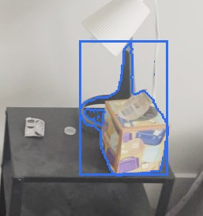 | 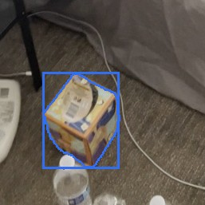 | 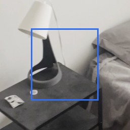 | 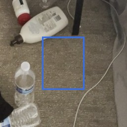 |

### 3. `MOVED` bedding

**confidence** 0.91 · **VLM verdict** confirmed · **motion** deformed · **appearance** cream-colored, soft fabric

The cream-colored bedding (soft fabric; about 1.1 x 0.5 x 0.2 m) was moved 0.4 m within the far part of the room (0.4 m above the floor both times), mostly by being rearranged or deformed rather than moved as a whole; the later video shows its old spot empty from 11 viewpoints and the earlier video shows the new spot empty from 5 viewpoints.

*Evidence:* old place seen empty from 11 views of the after video, new place from 5 views of the before video; appearance similarity 0.92; displacement 0.45 m; rotation (unreliable) 19 deg; motion deformed; mask score 0.81; VLM confirmed (Both outlined regions show the same cream-colored, patterned duvet or comforter, with identical fabric texture and decorative pattern visible in both images.)

| before | after | after video, old place | before video, new place |
|---|---|---|---|
| 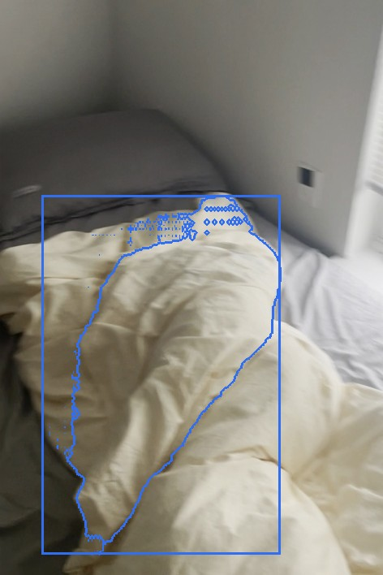 | 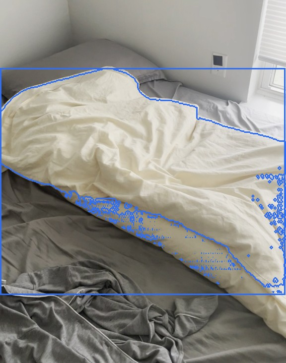 | 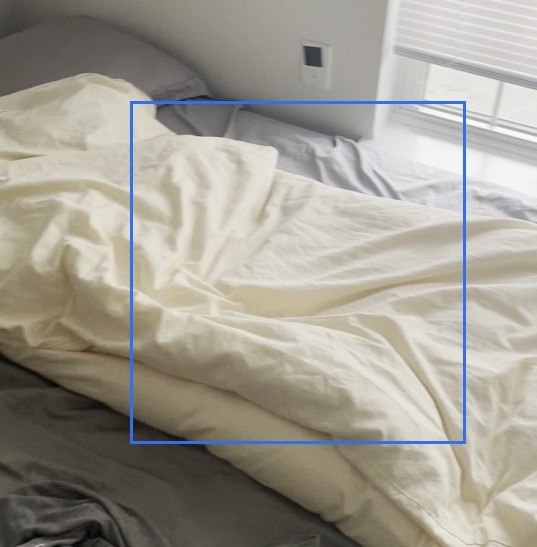 | 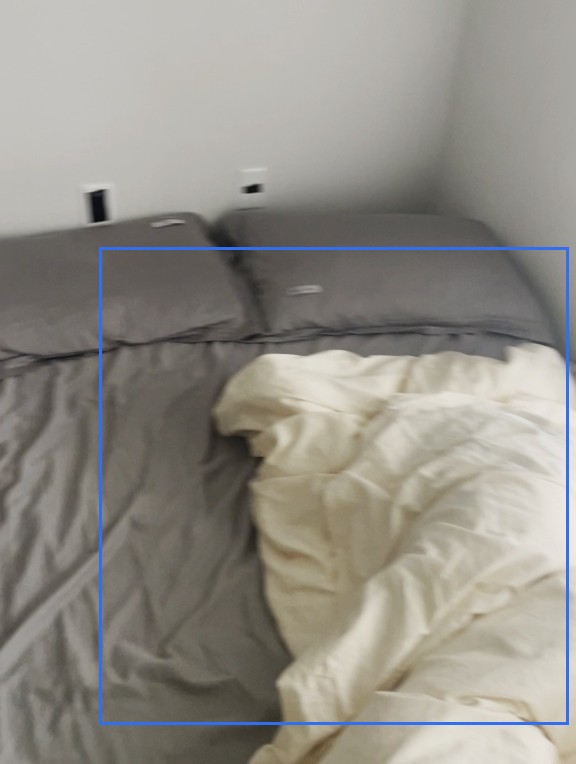 |

### 1. `REMOVED` black jacket

**confidence** 0.94 · **VLM verdict** confirmed · **appearance** black fabric

The black jacket (black fabric; about 0.9 x 0.5 x 0.2 m), which was on the floor in the near left part of the room, was removed: the later video looked at that spot from 7 viewpoints and saw it empty.

*Evidence:* place seen empty from 7 views of the after video (4045 free-space rays); mask score 0.96; VLM confirmed (The black jacket highlighted in image 1 is no longer present in the same spot in image 2, as the area is now empty carpet.)

| before | after |
|---|---|
| 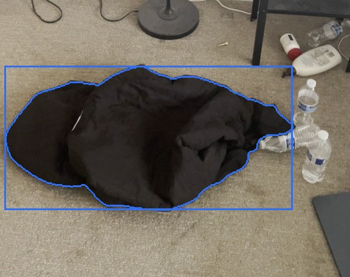 | 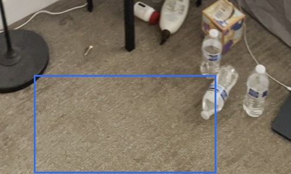 |

### 12. `UNVERIFIED` bedside table

**confidence** 0.36 · **VLM verdict** confirmed · **appearance** black metal

A bedside table (black metal; about 0.6 x 0.5 x 0.3 m), on the floor on the left side of the room, was only visible in the earlier video; the later video never looked at that spot, so this possible change cannot be verified.

*Evidence:* seen only in the before video; the after video never observed the place; mask score 0.76; VLM confirmed (The contour outlines a black bedside table with items on it, which is a distinct movable object.)

| before | after |
|---|---|
| 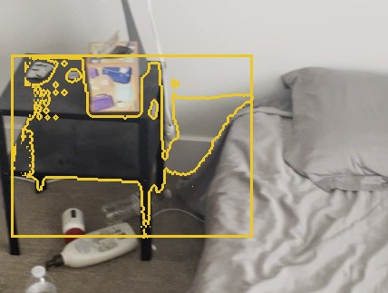 | 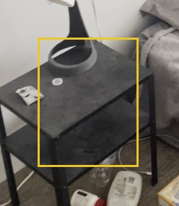 |

Rejected candidates (9)

- **4** removed *grey blanket*, confidence 0.91: in place: same; The grey blanket in image 1 is still present in image 2, though it appears more rumpled and less distinct due to different lighting and viewpoint. ([crop](crops/4_before.jpg))
- **5** removed *white duvet cover*, confidence 0.81: in place: same; The region inside the contour in both images shows the same crumpled white duvet cover, with no replacement or removal. ([crop](crops/5_before.jpg))
- **6** removed *white wall*, confidence 0.71: in place: same; The region inside the contour in both images is a plain white wall, with no objects or changes visible. ([crop](crops/6_before.jpg))
- **7** removed *white paper corner*, confidence 0.70: in place: same; The region in both images contains a plain white surface, likely a wall or a sheet, with no discernible change in object or content, only possible lighting or viewpoint differences. ([crop](crops/7_before.jpg))
- **8** removed *gray bed sheet*, confidence 0.68: in place: same; The region inside the contour in both images contains a gray bed sheet with wrinkles, and the only difference is lighting and viewpoint. ([crop](crops/8_before.jpg))
- **9** removed *floor lamp*, confidence 0.62: in place: same; The red contour in both images traces the same floor lamp, showing only minor differences in lighting and viewpoint. ([crop](crops/9_before.jpg))
- **13** added *crumpled white duvet*, confidence 0.94: In image 1, the highlighted area contains only rumpled grey sheets and part of a white duvet, but the white duvet is not the main focus or the only object; in image 2, the highlighted contour specifically isolates the crumpled white duvet as the primary object. The duvet was present in image 1 but was not the highlighted object there, so it was not absent. ([crop](crops/1_after.jpg))
- **10** added *bed sheet*, confidence 0.72: in place: same; The region inside the contour in both images contains a gray bed sheet with wrinkles, and the only difference is lighting and viewpoint. ([crop](crops/10_after.jpg))
- **11** unverified *wall*, confidence 0.41: The highlighted region is a section of the wall, not a distinct movable object. ([crop](crops/11_after.jpg))

## Coverage

- 72% of the before video's valid points lie where the after video could observe them (median distance there 0.8 cm).
- 79% of the after video's valid points lie where the before video could observe them (median distance there 0.8 cm).
- Reconstruction check: alignment OK.
- Places (left / right, near / far) are as seen along the average camera direction; distances are in approximate metres from the reconstruction.
