# RoomDiff report: scenediff_living_room_1

before video `original_video1.mp4`, after video `original_video2.mp4`; units: metres (approx.)

## Summary

6 changes: 2 moved, 1 added, 3 removed; 1 unverified. The light-colored floral curtain and the brown wooden ladder shelf both moved within the far part of the room, with the curtain now on the floor and the shelf lowered. The black leather wallet, dark brown leather bag, and white floral curtain were removed from their respective spots. A pink-handled hairbrush was added in the middle of the room. The white wooden dresser may have been added, but this cannot be verified because the earlier video did not show that area.

| type | count |
|---|---:|
| moved | 2 |
| removed | 3 |
| added | 1 |
| unverified | 1 |
| rejected candidates | 10 |

## Changes

### 1. `MOVED` curtain

**confidence** 0.92 · **VLM verdict** confirmed · **motion** rigid · **appearance** light-colored, floral pattern

The light-colored floral curtain (about 1.0 x 0.7 x 0.1 m) shifted 1.1 m within the far left part of the room (lowest point 0.5 m above the floor before, on the floor after) and rotated about 10 degrees; the later video shows its old spot empty from 6 viewpoints and the earlier video shows the new spot empty from 7 viewpoints.

*Evidence:* old place seen empty from 6 views of the after video, new place from 7 views of the before video; appearance similarity 0.78; displacement 1.11 m; rotation 10 deg; motion rigid; mask score 0.85; VLM confirmed (Both outlined regions show curtains with identical floral pattern and color, consistent material appearance, and same overall design, despite different lighting and poses.)

| before | after | after video, old place | before video, new place |
|---|---|---|---|
| 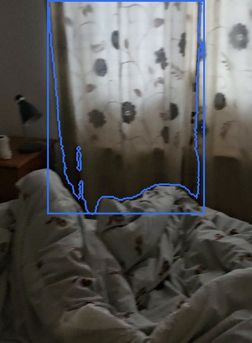 | 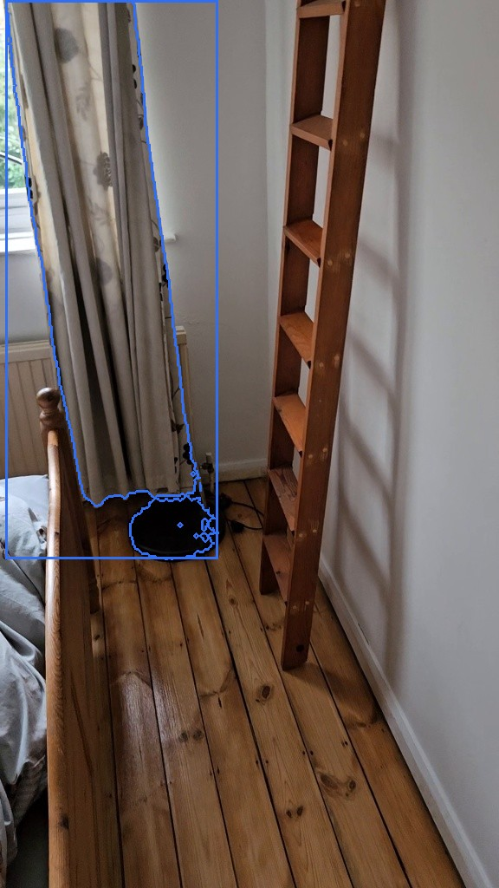 | 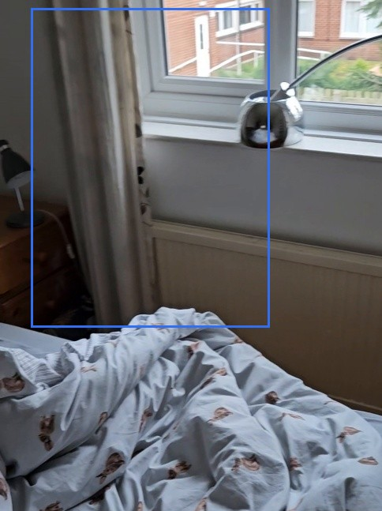 | 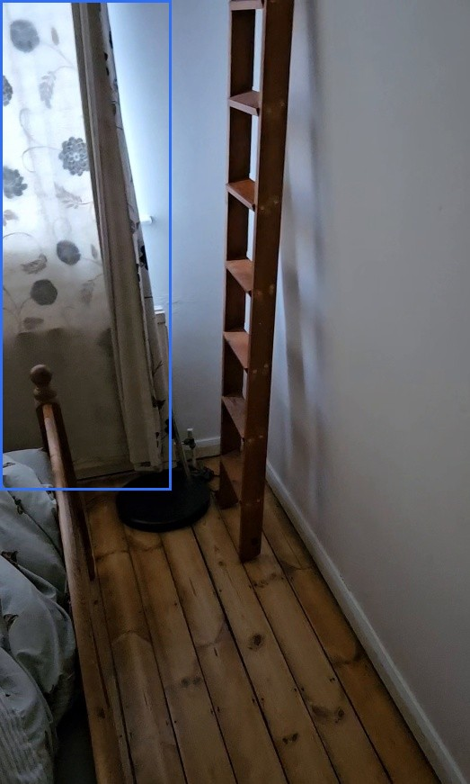 |

### 2. `MOVED` wooden ladder shelf

**confidence** 0.84 · **VLM verdict** confirmed · **motion** rigid · **appearance** brown wood

The brown wooden ladder shelf (about 1.4 x 0.5 x 0.1 m) moved 0.3 m within the far part of the room (lowest point 0.3 m above the floor before, on the floor after); the later video shows its old spot empty from 4 viewpoints and the earlier video shows the new spot empty from 9 viewpoints.

*Evidence:* old place seen empty from 4 views of the after video, new place from 9 views of the before video; appearance similarity 0.82; displacement 0.29 m; rotation 6 deg; motion rigid; mask score 0.81; VLM confirmed (The outlined objects are identical wooden ladder shelves with the same color, material, and design, including the same number and shape of rungs and side rails.)

| before | after | after video, old place | before video, new place |
|---|---|---|---|
| 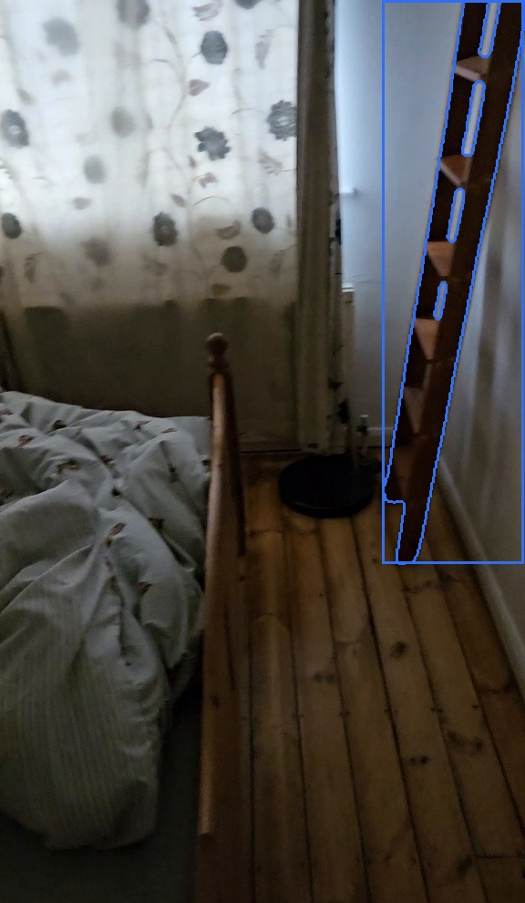 | 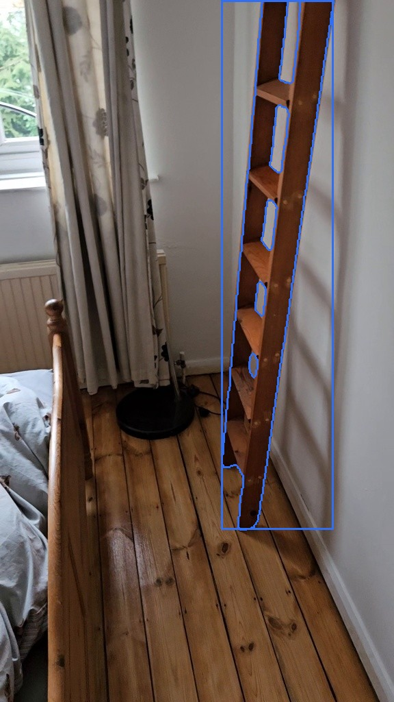 | 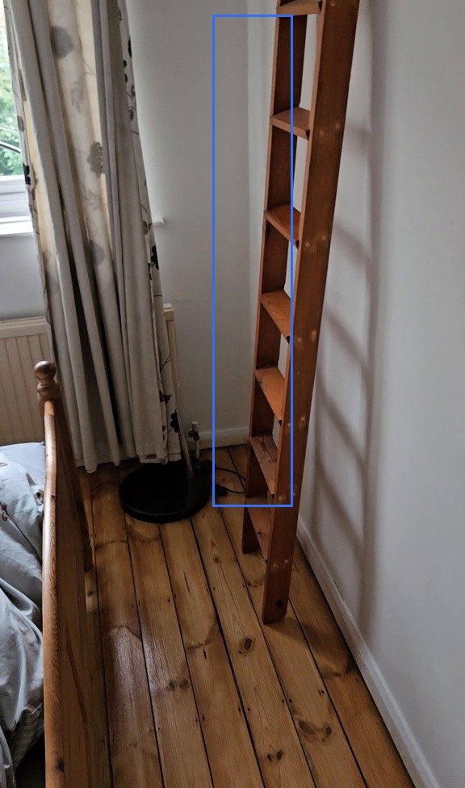 | 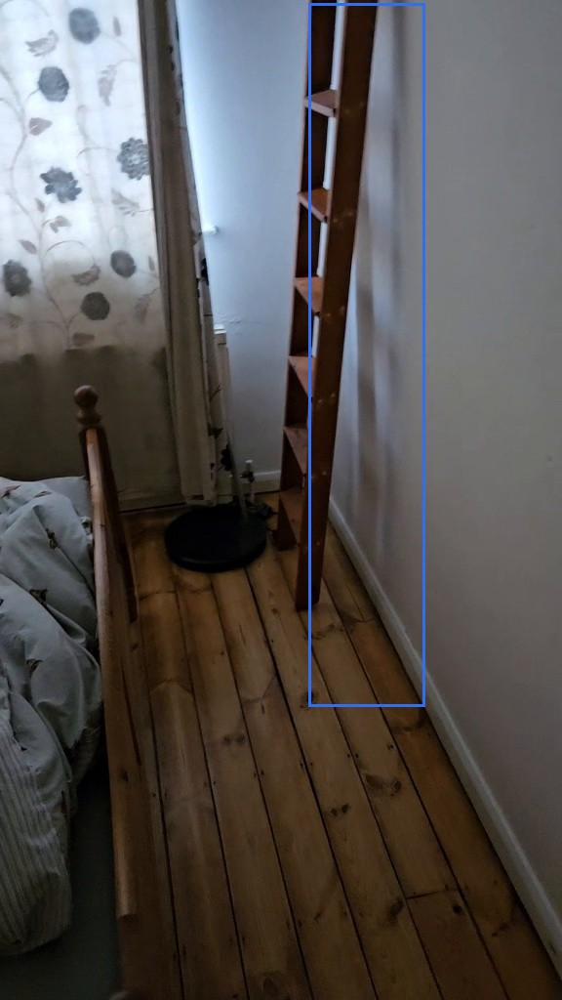 |

### 3. `REMOVED` black wallet

**confidence** 0.95 · **VLM verdict** confirmed · **appearance** black leather

The black leather wallet (about 10 x 10 x 2 cm), which was 0.6 m above the floor in the near right part of the room, was removed: the later video looked at that spot from 12 viewpoints and saw it empty.

*Evidence:* place seen empty from 12 views of the after video (0 free-space rays); appearance channel: score 0.73 (feature 0.73, depth 0.00) in 8 keyframes; in-place check: removed; mask score 0.96; VLM confirmed (in place: removed; The black wallet is gone in image 2, leaving only the bare surface.)

| before | after |
|---|---|
|  |  |

### 5. `REMOVED` brown leather bag

**confidence** 0.91 · **VLM verdict** confirmed · **appearance** dark brown, leather

The dark brown leather bag (about 0.4 x 0.3 x 0.2 m), which was on the floor on the right side of the room, was removed: the later video looked at that spot from 7 viewpoints and saw it empty.

*Evidence:* place seen empty from 7 views of the after video (2571 free-space rays); mask score 0.85; VLM confirmed (The brown object highlighted in image 1 is completely absent in image 2, which shows only the empty floor and wall corner within the same outlined region.)

| before | after |
|---|---|
| 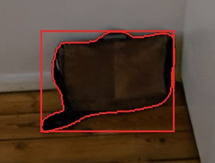 | 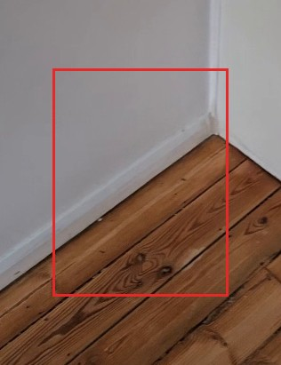 |

### 7. `REMOVED` curtain

**confidence** 0.85 · **VLM verdict** confirmed · **appearance** white with dark grey flowers

The white curtain with dark grey flowers (about 1.3 x 0.9 x 0.1 m), which was 0.5 m above the floor in the far left part of the room, was removed: the later video looked at that spot from 4 viewpoints and saw it empty.

*Evidence:* place seen empty from 4 views of the after video (1580 free-space rays); mask score 0.86; VLM confirmed (The curtain in image 1 is fully drawn and covers the window, while in image 2 the curtain is pulled aside, revealing the window and a lamp, so the curtain is no longer covering that spot.)

| before | after |
|---|---|
| 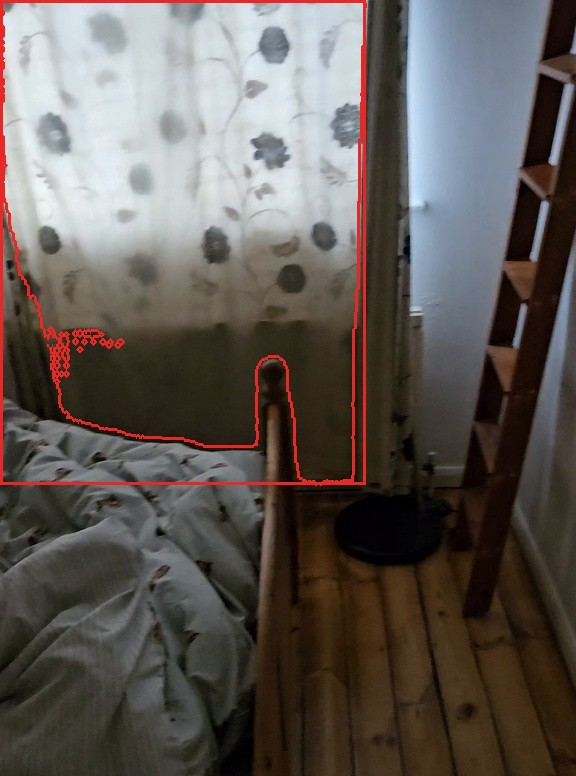 | 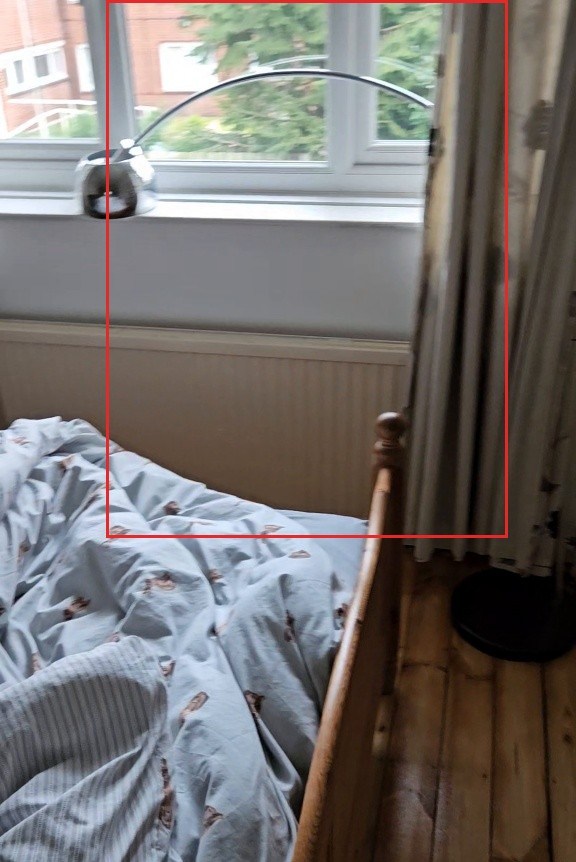 |

### 10. `ADDED` hairbrush

**confidence** 0.90 · **VLM verdict** confirmed · **appearance** black bristles, pink handle

The black-bristled pink-handled hairbrush (about 23 x 11 x 1 cm) appeared 0.4 m above the floor in the middle of the room: the earlier video looked at that spot from 11 viewpoints and saw it empty.

*Evidence:* place seen empty from 11 views of the before video (0 free-space rays); appearance channel: score 0.74 (feature 0.74, depth 0.00) in 6 keyframes; same place as removed change 4; in-place check: different; mask score 0.92; VLM confirmed (in place: different; The region outlined in image 1 contains a bed sheet, while image 2 shows a hairbrush in the same region, indicating a different object is present.)

| before | after |
|---|---|
| 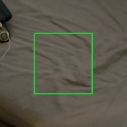 | 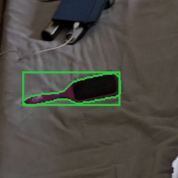 |

### 17. `UNVERIFIED` white dresser

**confidence** 0.38 · **VLM verdict** confirmed · **appearance** white, wooden

The white wooden dresser (about 1.6 x 1.3 x 0.7 m), on the floor in the near right part of the room, was only visible in the later video; the earlier video never looked at that spot, so this possible change cannot be verified.

*Evidence:* seen only in the after video; the before video never observed the place; mask score 0.78; VLM confirmed (The outline covers a white dresser with open drawers and scattered clothes, which are real physical objects.)

| after |
|---|
| 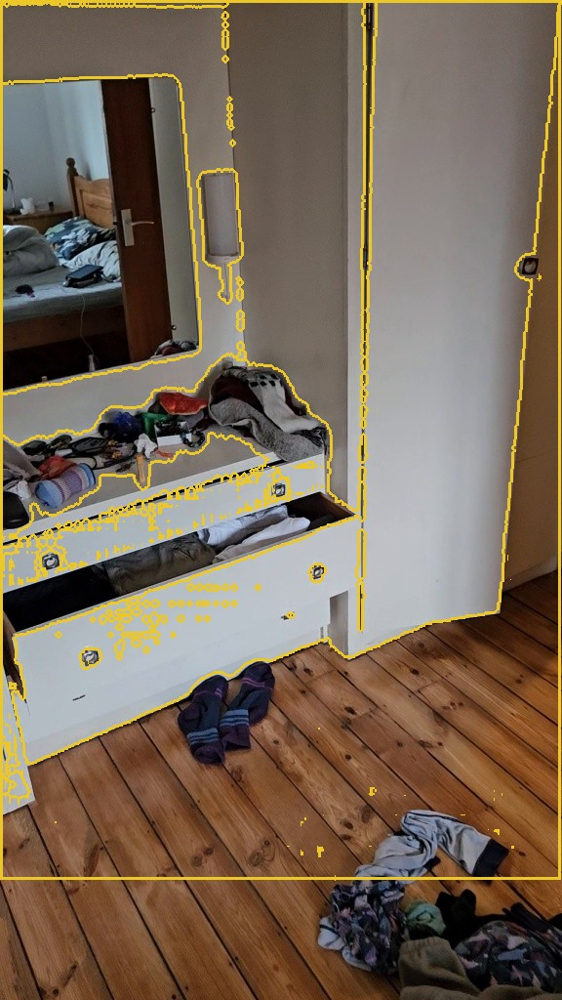 |

Rejected candidates (10)

- **4** removed *bed sheet*, confidence 0.93: named 'bed sheet' (part of the room or a bare surface): in place: different; The region outlined in image 1 contains a bed sheet, while image 2 shows a hairbrush in the same region, indicating a different object is present. ([crop](crops/4_before.jpg))
- **6** removed *pile of clothes*, confidence 0.89: in place: same; The red contour in image 1 traces a pile of clothes, which is still present in image 2, though the pile appears more spread out and less compact. The object is the same, just slightly rearranged. ([crop](crops/6_before.jpg))
- **8** removed *dark blanket*, confidence 0.80: in place: same; The object inside the contour in both images is the same plaid blanket, just with different lighting and slight folds. ([crop](crops/8_before.jpg))
- **9** removed *wall*, confidence 0.58: in place: same; The region in both images contains only a plain wall with no objects or changes, despite different lighting and viewpoints. ([crop](crops/9_before.jpg))
- **11** added *wooden floor*, confidence 0.87: in place: same; The region inside the contour in both images shows the same wooden floor surface, with no object present in either image. ([crop](crops/11_after.jpg))
- **12** added *wall-mounted mirror*, confidence 0.57: in place: same; The region inside the contour in both images shows a plain wall surface, with no objects present. The only differences are lighting and viewpoint, which aligns with 'same'. ([crop](crops/12_after.jpg))
- **13** unverified *wooden bed frame*, confidence 0.48: The contour covers part of a wooden floor and the base of a bed frame, which are part of the room's structure. ([crop](crops/13_before.jpg))
- **14** unverified *mirror reflection*, confidence 0.47: The highlighted region shows a reflection of a bed and floor, indicating it is inside a mirror. ([crop](crops/14_before.jpg))
- **15** unverified *wooden door*, confidence 0.46: The yellow outline traces a reflection of a wooden door in the mirror. ([crop](crops/15_after.jpg))
- **16** unverified *bed*, confidence 0.45: The highlighted region is a reflection of a bed with pillows and blankets in a mirror. ([crop](crops/16_after.jpg))

## Coverage

- 76% of the before video's valid points lie where the after video could observe them (median distance there 0.9 cm).
- 45% of the after video's valid points lie where the before video could observe them (median distance there 0.8 cm).
- Reconstruction check: alignment OK.
- Places (left / right, near / far) are as seen along the average camera direction; distances are in approximate metres from the reconstruction.
