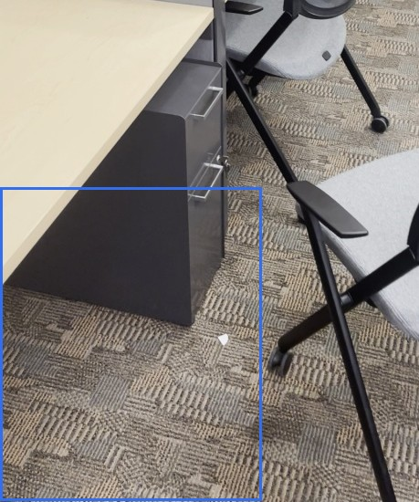
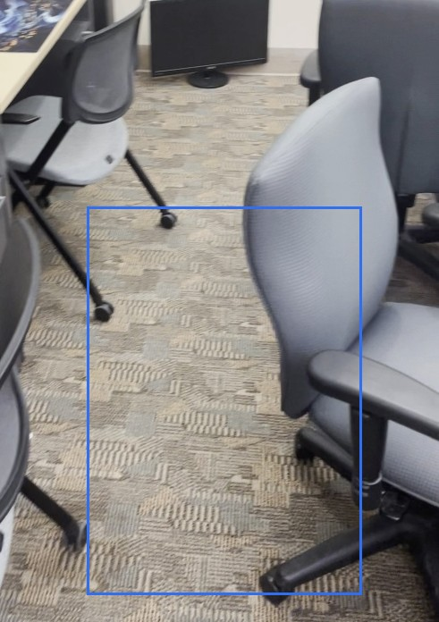
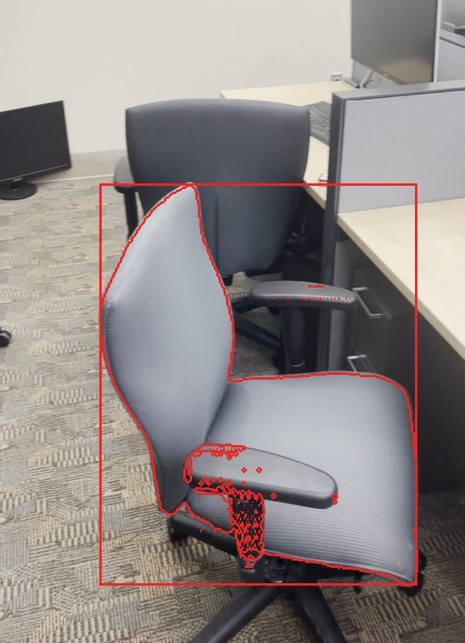
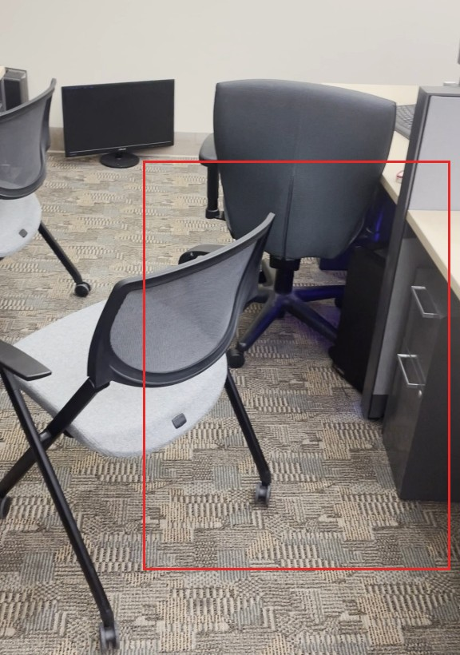
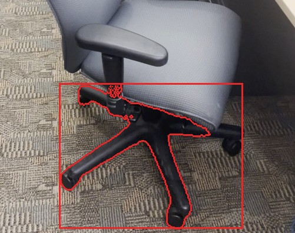

# RoomDiff report: scenediff_office_1

before video `original_video1.MOV`, after video `original_video2.MOV`; units: metres (approx.)

## Summary

2 changes: 1 moved, 0 added, 1 removed; 0 unverified. The office chair was moved slightly within the near part of the room and rotated, while another office chair was removed from the same area. The moved chair’s original spot appears empty in the later video, and the removed chair’s spot is also empty in the later video.

| type | count |
|---|---:|
| moved | 1 |
| removed | 1 |
| added | 0 |
| unverified | 0 |
| rejected candidates | 2 |

## Changes

### 1. `MOVED` office chair

**confidence** 0.93 · **VLM verdict** confirmed · **motion** rigid · **appearance** grey fabric seat, black mesh back

The office chair (grey fabric seat, black mesh back; about 0.5 x 0.5 x 0.4 m) was shifted 0.6 m within the near part of the room (lowest point 0.3 m above floor before, 0.2 m above floor after) and rotated about 54 degrees; the later video shows its old spot empty from 7 viewpoints and the earlier video shows the new spot empty from 32 viewpoints.

*Evidence:* old place seen empty from 7 views of the after video, new place from 32 views of the before video; appearance similarity 0.91; displacement 0.61 m; rotation 54 deg; motion rigid; mask score 0.87; VLM confirmed (The outlined objects are identical in color, material, and design: both are grey fabric seats with black mesh backs, black armrests, and black wheeled legs.)

| before | after | after video, old place | before video, new place |
|---|---|---|---|
|  |  |  |  |

### 3. `REMOVED` office chair

**confidence** 0.95 · **VLM verdict** confirmed · **appearance** gray fabric

The office chair (gray fabric; about 0.8 x 0.6 x 0.5 m), which was on the floor in the near part of the room, was removed: the later video looked at that spot from 32 viewpoints and saw it empty.

*Evidence:* place seen empty from 32 views of the after video (32325 free-space rays); merged from candidates 3, 2; mask score 0.89; VLM confirmed (The object highlighted in image 1 (a grey office chair) is no longer present in the exact same location in image 2; the chair has been replaced by a different chair (a grey mesh-back chair) in the same spot.)

| before | after | before, merged part |
|---|---|---|
|  |  |  |

Rejected candidates (2)

- **4** unverified *wall*, confidence 0.50: The contour covers a section of the wall and the top of office cubicle partitions, which are part of the room's structure. ([crop](crops/4_before.jpg))
- **5** unverified *white wall*, confidence 0.37: The outline covers a plain wall, which is part of the room structure. ([crop](crops/5_after.jpg))

## Coverage

- 78% of the before video's valid points lie where the after video could observe them (median distance there 0.5 cm).
- 85% of the after video's valid points lie where the before video could observe them (median distance there 0.4 cm).
- Reconstruction check: alignment OK.
- Places (left / right, near / far) are as seen along the average camera direction; distances are in approximate metres from the reconstruction.
