# RoomDiff report: tabletop_1

before video `before.mov`, after video `after.mov`; units: metres (approx.)

## Summary

3 changes: 2 moved, 0 added, 1 removed; 4 unverified. The white cardboard box was moved closer to the camera and rotated slightly, while the silver trash can was shifted slightly within the near left area and also rotated. The black and yellow tea canister was removed from its central position. Four other items — a light brown stool, a black office chair, a blue suitcase, and another light brown stool — were seen only in one video or the other, but their presence or absence cannot be verified due to limited camera coverage.

| type | count |
|---|---:|
| moved | 2 |
| removed | 1 |
| added | 0 |
| unverified | 4 |
| rejected candidates | 6 |

## Changes

### 1. `MOVED` white product box

**confidence** 0.92 · **VLM verdict** confirmed · **motion** rigid · **appearance** white cardboard

The white cardboard product box (about 0.3 x 0.3 x 0.1 m) was moved 0.8 m, from the middle of the room to the near part (0.8 m above the floor both times) and rotated about 54 degrees; the later video shows its old spot empty from 40 viewpoints and the earlier video shows the new spot empty from 33 viewpoints.

*Evidence:* old place seen empty from 40 views of the after video, new place from 33 views of the before video; appearance similarity 0.93; displacement 0.79 m; rotation 54 deg; motion rigid; mask score 0.95; VLM confirmed (The outlined objects are identical white product boxes with the same barcode, text, and red logo, and appear to be the same box in slightly different poses.)

| before | after | after video, old place | before video, new place |
|---|---|---|---|
| 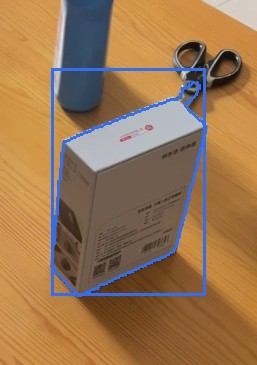 | 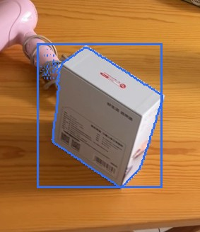 | 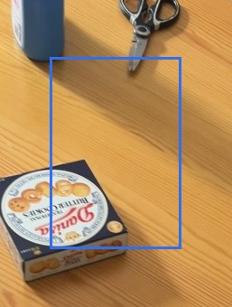 | 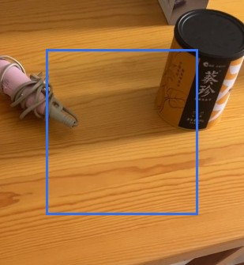 |

### 2. `MOVED` silver trash can

**confidence** 0.91 · **VLM verdict** confirmed · **motion** rigid · **appearance** silver metal

The silver metal trash can (about 0.5 x 0.3 x 0.2 m) was moved 0.2 m within the near left part of the room (on the floor both times) and rotated about 14 degrees; the later video shows its old spot empty from 7 viewpoints and the earlier video shows the new spot empty from 10 viewpoints.

*Evidence:* old place seen empty from 7 views of the after video, new place from 10 views of the before video; appearance similarity 0.91; displacement 0.19 m; rotation 14 deg; motion rigid; mask score 0.84; VLM confirmed (The outlined objects are identical silver trash cans with the same cylindrical shape, color, and visible label design, consistent across both images despite different camera angles and lighting.)

| before | after | after video, old place | before video, new place |
|---|---|---|---|
| 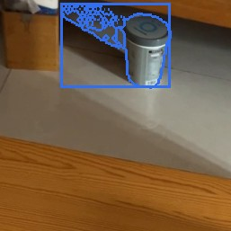 | 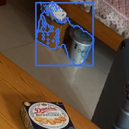 | 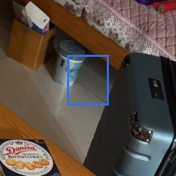 | 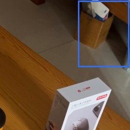 |

### 3. `REMOVED` tea canister

**confidence** 0.94 · **VLM verdict** confirmed · **appearance** black and yellow

The black and yellow tea canister (about 25 x 20 x 19 cm), which was 0.8 m above the floor in the middle of the room, was removed: the later video looked at that spot from 40 viewpoints and saw it empty.

*Evidence:* place seen empty from 40 views of the after video (27955 free-space rays); mask score 0.96; VLM confirmed (The tea canister is no longer in the highlighted spot in image 2; the area now contains only the wooden table surface.)

| before | after |
|---|---|
| 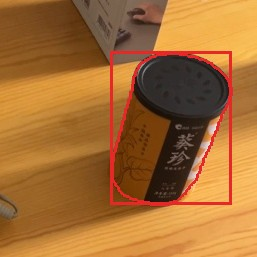 | 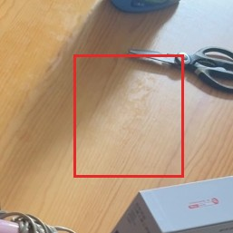 |

### 9. `UNVERIFIED` wooden stool

**confidence** 0.45 · **VLM verdict** confirmed · **appearance** light brown wood

The light brown wooden stool (about 3.4 x 0.6 x 0.2 m), on the floor in the far right part of the room, was seen only in the earlier video; the later video never looked at that spot, so this possible change cannot be verified.

*Evidence:* seen only in the before video; the after video never observed the place; mask score 0.89; VLM confirmed (The outline covers a light blue cup and a wooden stool, both distinct movable objects.)

| before | after |
|---|---|
| 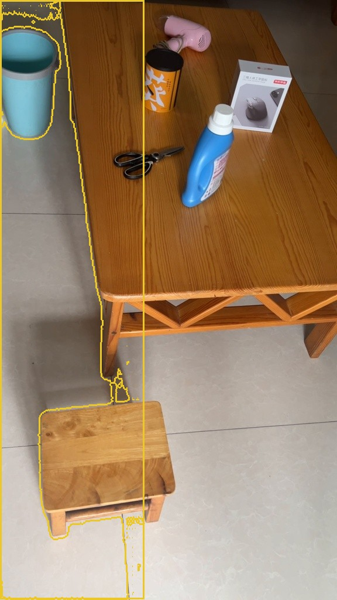 | 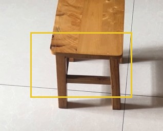 |

### 10. `UNVERIFIED` black office chair

**confidence** 0.45 · **VLM verdict** confirmed · **appearance** black plastic

The black plastic office chair (about 0.9 x 0.9 x 0.8 m), on the floor in the far left part of the room, was seen only in the later video; the earlier video never looked at that spot, so this possible change cannot be verified.

*Evidence:* seen only in the after video; the before video never observed the place; mask score 0.82; VLM confirmed (The outline traces the legs of a chair, a distinct movable object.)

| before | after |
|---|---|
| 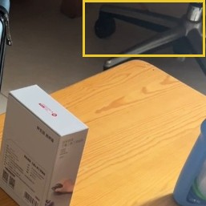 | 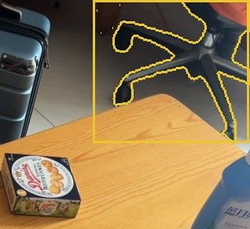 |

### 11. `UNVERIFIED` blue suitcase

**confidence** 0.43 · **VLM verdict** confirmed · **appearance** blue hard-shell

The blue hard-shell suitcase (about 3.7 x 1.0 x 0.2 m), on the floor in the far part of the room, was seen only in the earlier video; the later video never looked at that spot, so this possible change cannot be verified.

*Evidence:* seen only in the before video; the after video never observed the place; mask score 0.86; VLM confirmed (The contour covers a blue suitcase, a distinct movable object.)

| before |
|---|
| 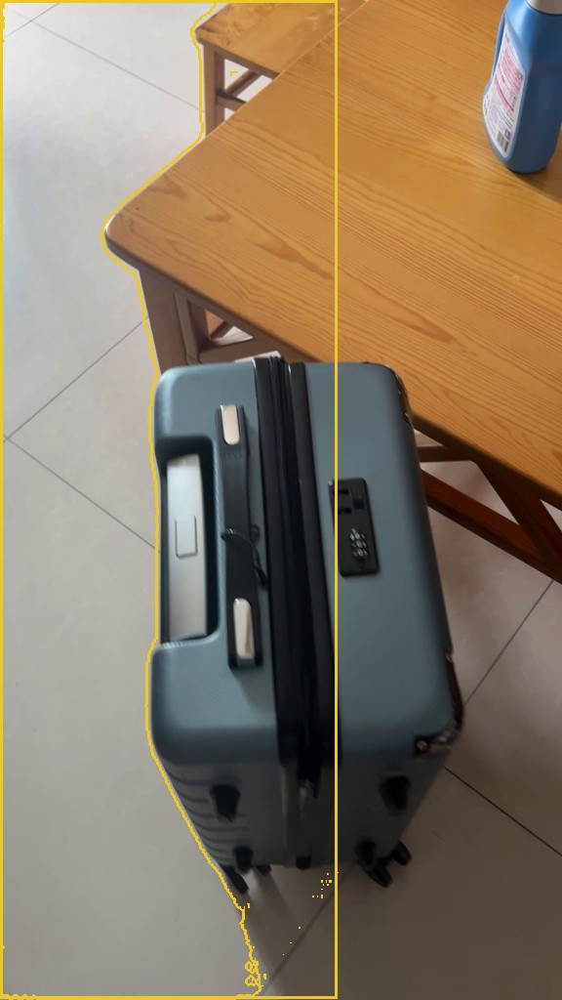 |

### 12. `UNVERIFIED` wooden stool

**confidence** 0.40 · **VLM verdict** confirmed · **appearance** light brown wood

The light brown wooden stool (about 1.9 x 1.5 x 0.2 m), on the floor in the far right part of the room, was seen only in the later video; the earlier video never looked at that spot, so this possible change cannot be verified.

*Evidence:* seen only in the after video; the before video never observed the place; mask score 0.76; VLM confirmed (The outline traces a wooden stool and part of a wooden table, both distinct movable furniture items.)

| before | after |
|---|---|
| 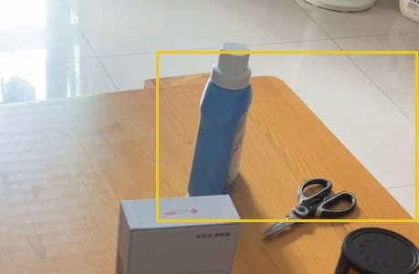 | 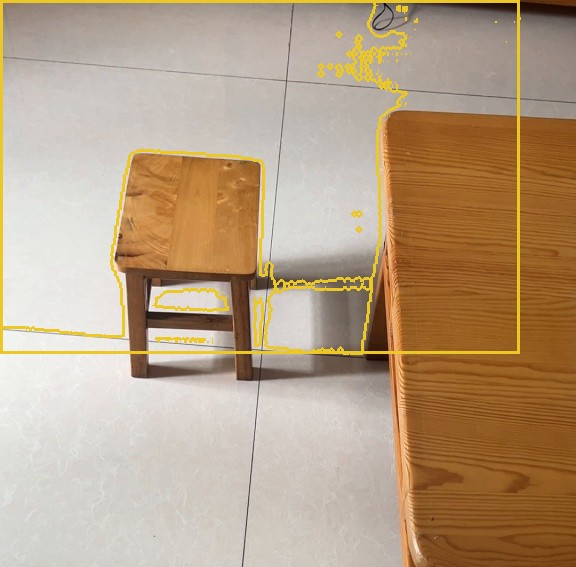 |

Rejected candidates (6)

- **4** removed *office chair leg*, confidence 0.73: in place: same; The region in both images contains the same office chair leg and floor, with no object replacement or removal. ([crop](crops/4_before.jpg))
- **5** removed *wooden floor*, confidence 0.68: in place: same; Both images show the same wooden floor surface within the marked region, with no object present in either image. ([crop](crops/5_before.jpg))
- **6** removed *wooden coffee table*, confidence 0.54: in place: same; The region inside the contour in both images contains a wooden table surface with a box of biscuits on it, indicating the same object is present in both images. ([crop](crops/6_before.jpg))
- **7** added *box of biscuits*, confidence 0.90: in place: same; The region inside the contour in both images contains a wooden table surface with a box of biscuits on it, indicating the same object is present in both images. ([crop](crops/7_after.jpg))
- **8** added *wooden coffee table*, confidence 0.76: in place: same; The blue bottle is present in both images, and the surface is the same wooden table top. ([crop](crops/8_after.jpg))
- **13** unverified *wooden stool*, confidence 0.34: The highlighted region covers part of a wooden table and tiled floor, which are real furniture and flooring. ([crop](crops/13_after.jpg))

## Coverage

- 69% of the before video's valid points lie where the after video could observe them (median distance there 0.9 cm).
- 77% of the after video's valid points lie where the before video could observe them (median distance there 0.9 cm).
- Reconstruction check: alignment OK.
- Places (left / right, near / far) are as seen along the average camera direction; distances are in approximate metres from the reconstruction.
