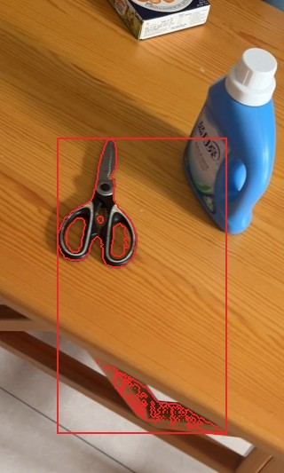
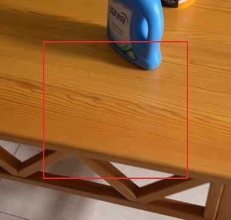
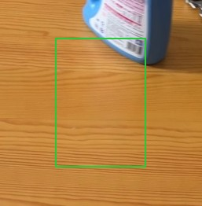
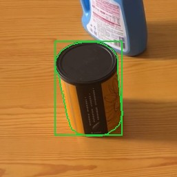
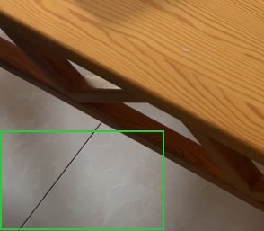
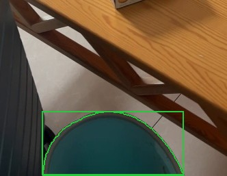
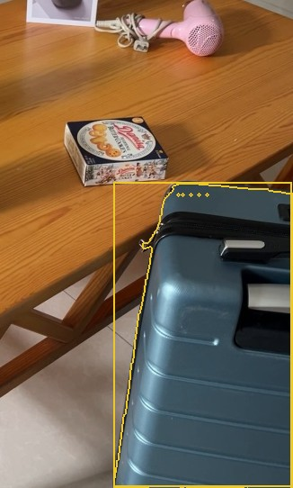

# RoomDiff report: tabletop_2

before video `before.mov`, after video `after.mov`; units: metres (approx.)

## Summary

3 changes: 0 moved, 2 added, 1 removed; 1 unverified. The black and silver scissors were removed from the middle of the room, while a black and gold tea canister and a green plastic bucket were added to the far part and left side of the room, respectively. A blue hard-shell suitcase may have appeared on the far left, but this cannot be confirmed as the earlier video did not capture that spot.

| type | count |
|---|---:|
| moved | 0 |
| removed | 1 |
| added | 2 |
| unverified | 1 |
| rejected candidates | 4 |

## Changes

### 1. `REMOVED` scissors

**confidence** 0.84 · **VLM verdict** confirmed · **appearance** black and silver

The black and silver scissors (about 0.8 x 0.2 x 0.1 m), located 0.8 m above the floor in the middle of the room, were removed; the later video shows that spot empty from 37 viewpoints.

*Evidence:* place seen empty from 37 views of the after video (200 free-space rays); appearance channel: score 0.70 (feature 0.70, depth 0.01) in 40 keyframes; in-place check: removed; mask score 0.87; VLM confirmed (in place: removed; The scissors are gone in image 2, leaving only the wooden table surface.)

| before | after |
|---|---|
|  |  |

### 2. `ADDED` tea canister

**confidence** 0.95 · **VLM verdict** confirmed · **appearance** black and gold

The black and gold tea canister (about 24 x 20 x 20 cm) appeared 0.8 m above the floor in the far part of the room; the earlier video looked at that spot from 23 viewpoints and saw it empty.

*Evidence:* place seen empty from 23 views of the before video (14373 free-space rays); mask score 0.96; VLM confirmed (The green contour in image 2 clearly highlights a tea canister that is not present in image 1, which only shows the empty wooden surface.)

| before | after |
|---|---|
|  |  |

### 3. `ADDED` green bucket

**confidence** 0.93 · **VLM verdict** confirmed · **appearance** green plastic

The green plastic bucket (about 0.4 x 0.3 x 0.2 m) appeared 0.3 m above the floor on the left side of the room; the earlier video looked at that spot from 9 viewpoints and saw it empty.

*Evidence:* place seen empty from 9 views of the before video (6829 free-space rays); mask score 0.96; VLM confirmed (Image 1 shows only the floor tile at that location, with no object present; Image 2 shows a green bucket in the same spot.)

| before | after |
|---|---|
|  |  |

### 8. `UNVERIFIED` blue suitcase

**confidence** 0.43 · **VLM verdict** confirmed · **appearance** blue hard-shell

The blue hard-shell suitcase (about 1.0 x 0.9 x 0.5 m), positioned 0.3 m above the floor in the far left part of the room, was only visible in the later video; the earlier video never looked at that spot, so this change cannot be confirmed.

*Evidence:* seen only in the after video; the before video never observed the place; mask score 0.96; VLM confirmed (The contour covers a blue suitcase, a distinct movable object.)

| after |
|---|
|  |

Rejected candidates (4)

- **4** unverified *wooden floor*, confidence 0.48: The highlighted region shows part of a floor, which is part of the room itself. ([crop](crops/4_after.jpg))
- **5** unverified *wooden table surface*, confidence 0.47: The highlighted region shows a section of a wall or ceiling, part of the room's structure. ([crop](crops/5_before.jpg))
- **6** unverified *wooden table leg*, confidence 0.45: The highlighted region shows part of the tiled floor and the leg of a wooden table, both real physical objects. ([crop](crops/6_after.jpg))
- **7** unverified *wooden chair leg*, confidence 0.44: The highlighted region shows a plain wall surface with a decorative border, not a reflection. ([crop](crops/7_before.jpg))

## Coverage

- 76% of the before video's valid points lie where the after video could observe them (median distance there 0.5 cm).
- 55% of the after video's valid points lie where the before video could observe them (median distance there 0.7 cm).
- Reconstruction check: alignment OK.
- Places (left / right, near / far) are as seen along the average camera direction; distances are in approximate metres from the reconstruction.
