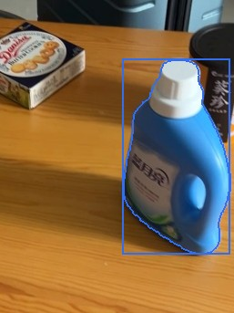
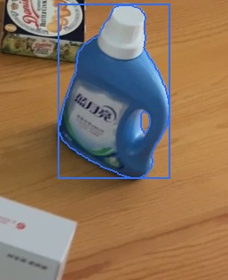
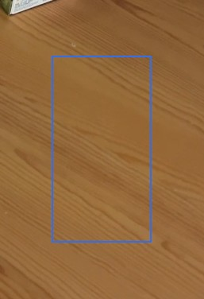
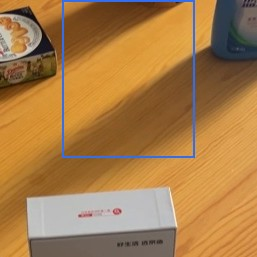
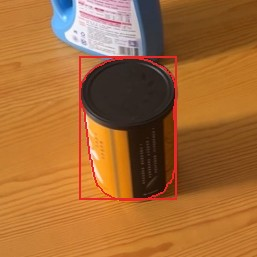
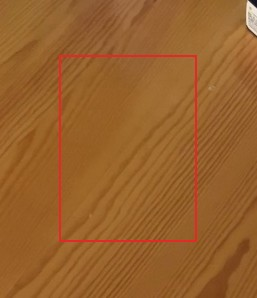
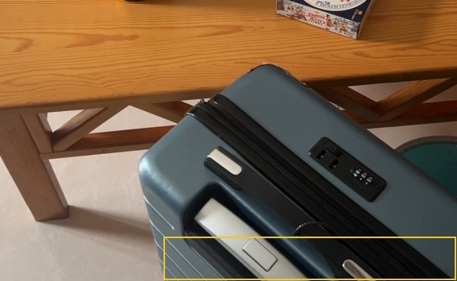
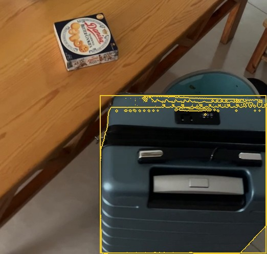
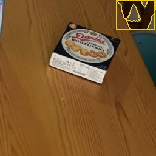

# RoomDiff report: tabletop_3

before video `before.mov`, after video `after.mov`; units: metres (approx.)

## Summary

2 changes: 1 moved, 0 added, 1 removed; 2 unverified. The blue laundry detergent was moved from near the front to the middle of the room and slightly rotated. The canned food on the right side is no longer there. Two other items — a blue suitcase and a box of butter cookies — appear only in the later video, but their presence cannot be confirmed due to camera angles not capturing those spots in the earlier video.

| type | count |
|---|---:|
| moved | 1 |
| removed | 1 |
| added | 0 |
| unverified | 2 |
| rejected candidates | 4 |

## Changes

### 1. `MOVED` blue laundry detergent

**confidence** 0.95 · **VLM verdict** confirmed · **motion** rigid · **appearance** blue plastic with white cap

The blue laundry detergent (blue plastic with white cap; about 0.4 x 0.3 x 0.1 m) was shifted 0.5 m, from near the front of the room to the middle (0.8 m above the floor both times) and rotated about 24 degrees; the later video shows its old spot empty from 23 viewpoints and the earlier video shows the new spot empty from 38 viewpoints.

*Evidence:* old place seen empty from 23 views of the after video, new place from 38 views of the before video; appearance similarity 0.96; displacement 0.53 m; rotation 24 deg; motion rigid; mask score 0.96; VLM confirmed (The blue laundry detergent bottle is identical in color, label, shape, and material in both images, indicating it is the same object.)

| before | after | after video, old place | before video, new place |
|---|---|---|---|
|  |  |  |  |

### 2. `REMOVED` canned food

**confidence** 0.95 · **VLM verdict** confirmed · **appearance** yellow and black metal

The canned food (yellow and black metal; about 24 x 20 x 19 cm), located 0.8 m above the floor on the right side of the room, was no longer there: the later video shows that spot empty from 23 viewpoints.

*Evidence:* place seen empty from 23 views of the after video (14265 free-space rays); mask score 0.97; VLM confirmed (The object highlighted in image 1 is a can, and image 2 shows the same spot on the floor with no can present, indicating the object is absent.)

| before | after |
|---|---|
|  |  |

### 7. `UNVERIFIED` blue suitcase

**confidence** 0.48 · **VLM verdict** confirmed · **appearance** blue hard-shell

The blue suitcase (blue hard-shell; about 0.7 x 0.7 x 0.3 m), positioned 0.4 m above the floor in the far right of the room, appeared only in the later video; the earlier video never captured that spot, so this change cannot be confirmed.

*Evidence:* seen only in the after video; the before video never observed the place; mask score 0.96; VLM confirmed (The contour covers a blue suitcase, a distinct movable object.)

| before | after |
|---|---|
|  |  |

### 8. `UNVERIFIED` donna butter cookies

**confidence** 0.47 · **VLM verdict** confirmed · **appearance** blue and white cardboard

The donna butter cookies (blue and white cardboard; about 23 x 21 x 20 cm), 0.2 m above the floor in the far part of the room, was seen only in the after recording; the before recording never looked at that spot, so this possible change cannot be verified.

*Evidence:* seen only in the after video; the before video never observed the place; mask score 0.94; VLM confirmed (The contour covers a small box of Danisa Butter Cookies on a wooden floor.)

| after |
|---|
|  |

Rejected candidates (4)

- **3** removed *wooden table surface*, confidence 0.72: in place: same; The region inside the contour in both images shows only the wooden table surface, with no objects present in either image. ([crop](crops/3_before.jpg))
- **4** removed *shadow*, confidence 0.60: in place: same; The region in both images shows the same floor area, with the same shadow pattern and no object present in either image. ([crop](crops/4_before.jpg))
- **5** added *wooden table*, confidence 0.85: in place: same; The same two objects (blue bottle and cookie tin) are present in both images, though their positions and the lighting differ. ([crop](crops/5_after.jpg))
- **9** unverified *wooden table*, confidence 0.43: The outline covers a wooden table with various items on it, including a bottle, a box, and a hair dryer. ([crop](crops/9_before.jpg))

## Coverage

- 46% of the before video's valid points lie where the after video could observe them (median distance there 0.6 cm).
- 79% of the after video's valid points lie where the before video could observe them (median distance there 0.6 cm).
- Reconstruction check: alignment OK.
- Places (left / right, near / far) are as seen along the average camera direction; distances are in approximate metres from the reconstruction.
